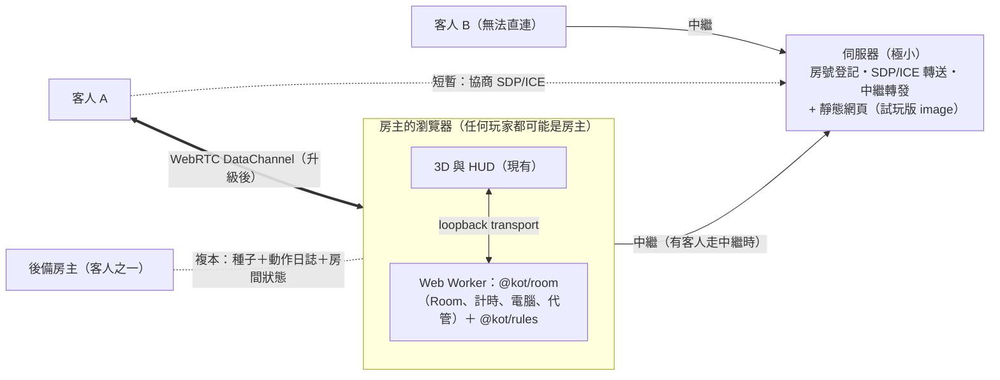

# ADR-0007：P2P（房主權威）架構與 M5 之後的重新規劃

- 狀態：**提議中（2026-11-11 修訂版）。使用者已回覆第一版的 6 個問題（見 §10），本版依回覆修訂；使用者同意本版後才開始 M5。**
- 取代：ADR-0002 的「伺服器權威、所有流量經過伺服器」——**但伺服器權威模式保留**（使用者決定，之後再決定是否移除）
- 相關：ADR-0005（大廳、身分、計時）、[cloud-run-demo runbook](../runbooks/cloud-run-demo.md)

## 1. 背景

### 1.1 問題

試玩版（單一容器、Cloud Run）用完了免費額度。已知事實（來源見文末）：

- Cloud Run 免費額度：每月 180,000 vCPU 秒、360,000 GiB 秒、200 萬次請求，**外送流量 1 GiB 僅限北美**。
- **WebSocket 連線開著的期間，該執行個體視為處理請求中，持續計費**；單一連線最長 60 分鐘就被平台切斷。
- 我們的客戶端斷線會自動重連，所以「開著網頁就離開」的分頁會一直續約。**M4.14（PR #18，已合併）加上了閒置踢除**（試玩版 5 分鐘）。它可能已經解決大部分試玩版的超量，但需要部署後看帳單才知道；它不解決「正式版規模變大後成本隨玩家數線性成長」。

### 1.2 流量其實很小，成本在「連線時間」

沙盒模擬（4 人局約 130 步、6 人局約 200 步）：每步一個視角狀態約 1.5–1.9 KB（gzip 後約 0.55 KB）＋事件約 0.16 KB；卡牌目錄約 10 KB（gzip 4 KB）。**一整局對所有玩家合計約 1–2.5 MB。** 問題不是資料量，而是「為了轉送這點資料，伺服器必須整場陪著每一位玩家」。

### 1.3 使用者的方向

1. 大部分流量與程式邏輯移到前端（P2P），伺服器只保留必要功能。
2. **不影響目前功能**。
3. 正式版必須把靜態網頁放到免費 CDN；**試玩版仍要「一個 demo image 就能部署」**。
4. 試玩版可能改放 Railway（免綁信用卡、從 Docker Hub 拉 image、額度用完被強制關閉而不是被扣款）。
5. **不另外用 TURN 服務**，改由自家伺服器的 WebSocket 轉發（§2.5）。
6. **任何玩家都可以當房主**（包含手機）；**要做房主轉移**（§4）。
7. 信任等級：朋友間遊玩即可（§3）。

## 2. 決策（提議）

**房主權威的星狀 P2P：** 建房的人（房主）的瀏覽器執行規則引擎與房間邏輯；其他玩家連到房主，收發的**就是現有的協定訊息**（`@kot/protocol`，包含視角過濾後的狀態與事件）。伺服器退化成「房號登記＋訊息轉發（備援）＋靜態檔」。

連線路徑有兩條，**同一份協定、同一個 `Transport` 介面**：

1. **中繼（relay）：** 客人與房主各自連到伺服器的 WebSocket，伺服器只依房號與對象轉發不透明的訊息。**一定連得上**（WSS／443）。
2. **WebRTC DataChannel：** 瀏覽器直連，不經伺服器。

**中繼優先、WebRTC 背景升級：** 客人一加入就走中繼（立刻能玩、不會因為 NAT 而失敗），同時在背景協商 WebRTC；成功就無縫切換並關掉自己的中繼連線，失敗就留在中繼並顯示「中繼模式」。這比「先試 WebRTC、失敗再退回」簡單，也讓「連不上」這種狀況不存在。

### 2.1 為什麼是這個形狀

- **Room 本來就是可攜的。** `Room` 透過注入的 `Scheduler`、`Publisher`、`randomInt` 運作，沒有直接碰 Socket.IO；規則引擎是純函式。要搬的是「執行位置」，不是重寫。
- **協定不變。** 畫面層不需要知道訊息從哪條路來；只換 transport。
- **伺服器權威模式保留**（同一個 `@kot/room` 跑在 Node），是「嚴格公平」場合的備援。

### 2.2 伺服器只剩什麼

| 功能     | 說明                                                                                                                           |
| -------- | ------------------------------------------------------------------------------------------------------------------------------ |
| 靜態網頁 | 試玩版：同一個 image 提供（現狀）；正式版：搬到 CDN（本來就必須）                                                              |
| 房號登記 | 防重複、`MAX_ROOMS`、房號所有權（含房主轉移時的接手驗證，§4）                                                                  |
| 信令     | 轉送 SDP/ICE（只在 WebRTC 協商時）                                                                                             |
| 中繼     | 只轉發不透明訊息：限房內成員、訊息大小與頻率上限、單房頻寬上限；**不解析、不記錄訊息內容**（內含 session token，同現在的規則） |
| 健康檢查 | 現有 `/healthz`                                                                                                                |

### 2.3 連線生命週期與「讓伺服器能睡覺」

連線時間才是成本，所以伺服器上的 WebSocket 只在需要時才存在：

1. **加入：** 客人連中繼 → 立刻進房（秒級）→ 背景協商 WebRTC。
2. **升級成功：** 客人關掉中繼連線。房主的中繼連線在「沒有任何客人走中繼」時也關掉（但**大廳階段房主保持連線**等新客人）。
3. **開局後全員直連：** 伺服器上沒有這個房間的連線，可縮到 0（Cloud Run）或睡眠（Railway Serverless，約 5–10 分鐘沒有對外封包）。
4. **有人掉線或有人無法直連：** 房主重新連線；掉線的人重新走 1。
5. 閒置踢除（M4.14）沿用於所有伺服器連線。

**這是設計目標，不是已驗證的數字。** 成本取決於「無法直連的比例」：若約 1/6 的客人必須走中繼（Chrome 通話資料，僅作量級參考），這些房間的房主也要整場保持連線，因此這類房間的伺服器連線時間約是現在的 1/3～1/2、其他房間幾乎為 0；**需要在 M7 之後用真實網路量測**。

### 2.4 不影響現有功能（對照表）

| 現有功能                        | P2P 後在哪裡                                   | 備註                                                                  |
| ------------------------------- | ---------------------------------------------- | --------------------------------------------------------------------- |
| 規則引擎、卡牌效果、重播        | 房主的 Worker                                  | 不變；客人不需要引擎（只需要 `describeEvent` 等顯示用函式）           |
| 大廳、準備、房主、開局          | 房主的 Worker                                  | `Room` 搬位置                                                         |
| 分享連結 `?room=CODE`           | 不變                                           | 客人用房號向伺服器找房主                                              |
| 電腦玩家（smartBot）            | 房主的 Worker                                  | 計算量在房主的瀏覽器；Worker 避免卡住畫面。房主轉移後由新房主接手     |
| 逾時代管、away、決策計時        | 房主的 Worker                                  | 背景分頁計時器的風險見 §8                                             |
| 重連（token）                   | 房主發 token；客人存 localStorage              | 同現在，簽發者從伺服器變房主；房主轉移時 token 雜湊隨房間狀態交給後備 |
| 12 隻怪獸隨機分配               | 房主                                           | `randomInt` 改用 Web Crypto                                           |
| 自備卡表（CSV）                 | 房主在本機載入，透過協定傳給客人（與後備房主） | **更好**：我們不必在任何伺服器放第三方資料                            |
| 視角過濾（`redactState`）       | 房主對每位客人各算一份                         | 不變                                                                  |
| 速率限制、`MAX_ROOMS`、連線上限 | 伺服器（登記與中繼）＋房主端對客人訊息限流     |                                                                       |
| 3D 導演、特效、HUD              | 不變                                           |                                                                       |
| 負載測試 10,000 連線            | 改成各自的容量目標（§7）                       | 伺服器權威模式仍可用原目標量測                                        |

### 2.5 評估：用自家 WebSocket 中繼取代 TURN

**結論：可行，建議採用，並且不再規劃 TURN。**

| 面向         | 評估                                                                                                                                                 |
| ------------ | ---------------------------------------------------------------------------------------------------------------------------------------------------- |
| 功能         | 與 TURN 等效的備援（對方連不上就由第三者轉發），而且**涵蓋更廣**：WSS／443 幾乎所有網路都通，TURN/UDP 在擋 UDP 的網路會失敗                          |
| 需要的新東西 | 無：伺服器本來就有 Socket.IO；多一個 `RelayTransport`（實作同一個 `Transport` 介面）與轉發端點。不需要憑證端點、不需要第三方帳號、**沒有信用卡問題** |
| 流量成本     | 遊戲流量很小（§1.2，一局合計約 1–2.5 MB），轉發頻寬不是問題                                                                                          |
| 連線時間成本 | **這才是代價**：走中繼的客人與其房主要整場連著伺服器。只影響「無法直連的比例」那部分；用 §2.3 的方式限縮                                             |
| 延遲         | 多一跳（客人→伺服器→房主）。伺服器放台灣時對台灣玩家影響小；**未量測**                                                                               |
| 安全         | 伺服器看得到明文訊息（含 token）。它是我們自己的伺服器，規則是「不記錄內容」。端對端加密可做但**不建議列入範圍**（使用者已接受信任等級）             |
| 濫用         | 中繼不能變成通用轉發：限房內成員、大小與頻率上限、單房頻寬上限、每 IP 限制                                                                           |
| 風險         | 中繼成為單點：伺服器掛了，走中繼的玩家就斷（直連的不受影響）。與現況相比風險較低                                                                     |

## 3. 信任模型（已確認：朋友間遊玩的等級夠）

房主的瀏覽器擁有完整狀態：**牌庫順序與骰子的亂數狀態都在房主手上。** 被竄改的房主客戶端可以偷看接下來的骰子或牌、或虛報結果。這是 P2P 無法避免的代價（要真正隱藏需要「心理撲克」等密碼學，不在範圍內）。**房主轉移會讓後備房主也持有這些資訊**（見 §4.8），與上面同一等級。

緩解（皆為後續里程碑，**不保證完全防作弊**）：

1. **誠實預設：** 房主自己的畫面也只用視角過濾後的資料。
2. **種子共同產生（commit–reveal）：** 開局種子由所有玩家各貢獻一份亂數混合，房主無法「挑好種子」。
3. **賽後稽核：** 結束時公開種子與動作日誌，所有客人用規則引擎重播並比對結果；可偵測「竄改」，**偵測不到「偷看」**。房主轉移的複本日誌可以共用。
4. **嚴格模式：** 保留伺服器權威模式。

README 與房間畫面需要明講這個信任等級。

### 3.1 評估：能不能把牌庫順序與亂數狀態加密或雜湊？

**雜湊不行**：雜湊是單向的，引擎需要的是真正的牌序與亂數位置，雜湊之後就拿不回來。

**加密只能「遮蔽」，不能「防止」**：引擎要用這份資料，解密的金鑰就必須放在同一個瀏覽器裡（房主）；故障接手時，金鑰也得在後備房主手上。所以懷有惡意、會寫程式的房主一樣拿得到。它擋得住的是「隨手開 DevTools／網路面板就看到明文」這一層。

可以做、成本低的遮蔽（**M10 選配，不算防作弊**）：

1. **引擎狀態只放在 Worker**（M5 就是這樣）：頁面的 console 與 `window` 拿不到，要進 Worker 的偵錯視窗才看得到。
2. **複本與重整接回用的日誌（IndexedDB、傳給後備）用每房一把金鑰（AES-GCM）加密**：沒有金鑰的人（看網路封包、翻 IndexedDB）看不到種子與牌序。注意 Web Crypto 的 `subtle` 只在安全連線（HTTPS／localhost）可用，區網 http 要退回不加密並提示。
3. **牌序不整副展開、種子不存進任何會被記錄的地方**（現況已是：種子不送客戶端、不寫 log）。

真正能提高作弊成本的是 §3 的「種子共同產生」與「賽後稽核」；要完全隱藏需要密碼學協定（心理撲克），不在範圍內。

## 4. 評估：房主轉移

**結論：可行；難度為「L、風險中到高」（分散式一致性），但我們有兩個很大的優勢：** (a) 規則引擎是**確定性**的——同一個種子與同一串動作一定得到同一個狀態，連骰子都一樣；(b) `Room` 已經用可注入的時鐘與傳輸，**可以用確定性模擬器做故障注入測試**（在每一個動作邊界讓房主消失、延遲、斷網），沙盒就能驗證邏輯。真實網路的時序仍需要實測。

### 4.1 兩種情境

| 情境           | 觸發                                                                                                                   | 是否無損                                         |
| -------------- | ---------------------------------------------------------------------------------------------------------------------- | ------------------------------------------------ |
| **計畫性交接** | 房主按「換人當房主」；或房主的分頁進入背景／即將關閉（`visibilitychange`、`pagehide`，**盡力而為，手機不保證會執行**） | 無損：先停止提交、送出最後一筆、對方確認後才切換 |
| **故障接手**   | 房主的連線中斷、超過寬限期                                                                                             | 可能遺失尾端少數動作（§4.4）                     |

### 4.2 後備房主與複本

- 房主依「裝置類型（桌面優先）、是否在前景、連線品質、是否為直連」排出**後備順序**，廣播給所有人，**所有人用同一張表**，不需要投票。
- 第一順位後備（standby）持續收到**複本**：開局設定（含卡牌定義與其雜湊）、**種子**、**動作日誌**（含代管與電腦的動作）、房間層狀態（成員、座位、怪獸、token 雜湊、準備／離開狀態、計時器剩餘）、epoch。每提交一筆就增量送出（約 0.1–0.3 KB）。
- 後備用「種子＋日誌」**重播**就能重建完整引擎狀態（含牌庫順序與亂數位置），不需要傳整個狀態。重播也是 M10 稽核的材料。
- `Room` 需要新增 `snapshot()`／`restore()`（房間層狀態的序列化）；引擎層已經有 `replay`。

### 4.3 偵測與接手（依序遞補：房主 → 第一順位 → 第二順位 → …，直到沒人可接）

後備順序是**所有人共用的一張表**（§4.2），所以不需要投票，每個人都知道「下一個是誰」。

1. 客人與房主之間有心跳（約每 2 秒；約 6 秒沒回應視為疑似掉線），加上連線關閉事件。
2. **寬限期（預設 10 秒）：** 房主可能只是重整頁面——M8 的「房主重整接回」讓他自己回來，這時不需要轉移。
3. 寬限期過後，**排名第 k 位的後備在「寬限期 + (k−1)×3 秒」時自我提升**（第一順位 10 秒、第二順位 13 秒、第三順位 16 秒…）：`epoch + 1`，向伺服器宣告接手同一個房號。伺服器驗證「接手令牌」（房主建房時簽發、帶順位與 epoch），**不需要知道任何遊戲內容**。
4. **前一位沒接手就換下一位：** 若第一順位也離線或沒有宣告，第二順位在自己的時間到時，發現沒有更高 epoch 的新房主，就接手；以此類推。已經有人接手時，後面的順位看到宣告就不動作。
5. 其他客人收到新房主宣告後連過去（中繼或重新協商 WebRTC）。新房主廣播一次**完整重送**（帶 epoch），客人的畫面同步到新狀態。
6. **舊房主或較前順位又回來：** 看到更高的 epoch，**降為客人**，捨棄自己的本機日誌，改收新房主的完整重送。
7. **沒人可接時：** 所有真人都斷線，房間依現有規則保留一段時間（`emptyRoomMs`）等人回來，逾時關閉；任何一位真人回來就成為房主（沿用 §4.2 的複本）。**只剩一位真人加電腦玩家時，這位真人就是房主，對局照常進行。**

### 4.4 一致性取捨

- **預設：非同步複寫。** 房主先在本機套用動作、增量送給後備、**立刻**廣播給客人，不等後備確認（避免每個動作多一個來回）。故障時最多遺失尾端少數動作。
- **遺失尾端動作的後果有限：** 引擎是確定性的，那位玩家重做同一個動作會得到**相同的骰子結果**（結果由種子與序號決定，與時機無關）。公平性不受影響；使用者只是需要重做。
- 選配：同步複寫（等後備確認才廣播），代價是每個動作多一個來回延遲；預設不開。

### 4.5 分裂腦（兩個人都自認是房主）

- 客人**只接受最高 epoch** 的房主。相同 epoch 的衝突以後備順序決定。
- 分區時一部分客人可能還連著舊房主：舊房主會因為「後備與（過半）客人都斷線」而**暫停提交**（fencing）；伺服器的房號所有權也只認最新 epoch。
- **2 人局特例：** 只有 1 位客人，他就是後備，必須接手；不做多數決。
- 這是整個設計裡最需要測試的部分（§4.9）。

### 4.6 電腦、代管、計時器

新房主依房間狀態重建：電腦玩家照常由新房主的 Worker 出手；away 標記保留；**決策計時重新給一整段時間**（不繼承舊的剩餘時間）。

### 4.7 房主是手機的情況（使用者決定：任何人都可以當房主）

手機分頁在背景可能被暫停，所以這正是「計畫性交接」與「後備順序偏好桌面」的用途：房主分頁隱藏超過數秒就主動交接；後備順序把桌面、前景、直連的排前面。手機能當房主，但**體驗較差、較耗電**，畫面上要提示「請保持螢幕開啟」並使用 Wake Lock。細節與證據見 §8。

### 4.8 隱藏資訊

後備房主拿到種子，等於也看得到牌庫與骰子。信任等級已確認夠（§3）。可選的加強（**不列入計畫**）：複本以金鑰加密、金鑰只在交接時釋出——但故障接手時金鑰在消失的房主手上，所以做不到；結論是不做，文件明講。

### 4.9 測試策略（沙盒可驗證的部分）

- **確定性故障注入：** 用模擬傳輸與可控時鐘，跑完整對局（含電腦與卡牌）；在每一個動作邊界讓房主消失、延遲複寫、分區；驗證最終結果等於「無故障時的結果」，或等於「合法的尾端回滾後的結果」，且不變條件全程成立。
- 計畫性交接：任何時間點交接都必須無損（日誌完全一致）。
- 分裂腦：兩個「房主」同時存在時，客人只跟隨最高 epoch；舊房主降為客人。
- **未實測：** 真實網路延遲與封包遺失下的偵測時間、手機行為。

### 4.10 分階段

房主轉移依賴 M5（可攜 Room）、M6（房主權威）、M7（多條連線路徑）與 M8（日誌與重整接回）。所以放在 **M9**；M8 的「房主重整接回」先解決最常見的狀況（房主重新整理頁面）。

## 5. 替代方案

| 方案                        | 優點                   | 不採用／暫不採用的原因                                                                                   |
| --------------------------- | ---------------------- | -------------------------------------------------------------------------------------------------------- |
| A. 現狀＋閒置踢除（M4.14）  | 已完成、零風險         | 仍是「每位玩家整場佔一條伺服器連線」；規模大時成本線性成長。**可能已足夠撐試玩版**，但不能解決正式版成本 |
| B. 每位玩家都跑引擎（鎖步） | 沒有單點               | 隱藏資訊（牌庫、亂數）無法保密；需要複雜的密碼協定                                                       |
| C. 只做靜態搬家（CDN）      | 立刻降低請求與流量     | 不減少 WebSocket 連線時間；仍然必做（正式版）                                                            |
| D. 第三方 TURN              | 標準做法               | **使用者決定不採用**（§2.5：自家中繼更簡單、涵蓋更廣、不用新帳號）                                       |
| E. 公開信令（Trystero 等）  | 完全不需要自己的伺服器 | 公開中繼**不保證高可用**；可作為可插拔的備用實作，不列入範圍                                             |

## 6. 里程碑（取代原本的 M5／M6）

大小：S＝數天、M＝約 1–2 週、L＝2 週以上（粗估，未含審查）。

| 里程碑 | 內容                                                                                                                                                                                                                                         | 大小 | 沙盒可驗證                         | 驗收                                                                                           |
| ------ | -------------------------------------------------------------------------------------------------------------------------------------------------------------------------------------------------------------------------------------------- | ---- | ---------------------------------- | ---------------------------------------------------------------------------------------------- |
| M5     | **可攜核心＋離線對電腦**：抽出 `packages/room`（Room、計時、電腦、代管；去掉 `node:crypto`；新增 `snapshot()`／`restore()` 的介面草案）；`packages/cardsets` 拆成純解析與檔案載入；`Transport` 介面（Socket.IO／Loopback）；Worker 執行 Room | L    | 全部（單元、整合、Playwright）     | 既有測試全數通過；**不連伺服器就能「房主＋電腦」玩完整局**（`?offline=1`）；伺服器模式行為不變 |
| M6     | **房主權威＋中繼**：房號登記與中繼端點（限流、大小與頻寬上限）；`RelayTransport`；客人與房主走中繼完成整局；token 由房主簽發；分享連結走房號登記。**此時還沒有 WebRTC，但伺服器已經不跑遊戲邏輯**                                            | L    | 全部（多分頁）                     | 兩到六個分頁完成整局；中繼只轉發不透明訊息（測試確認伺服器不解析遊戲訊息）；伺服器模式不受影響 |
| M7     | **WebRTC 升級**：背景協商 SDP/ICE、成功後無縫切換並關掉中繼連線、失敗留在中繼；訊息分段（>16 KB）；中繼／直連的指示；「沒有人走中繼就關閉房主的中繼連線」                                                                                    | M    | 多分頁 WebRTC（本機回圈）          | 直連成功時伺服器上沒有該房連線；切換不掉訊息；真實 NAT／網路**未實測**                         |
| M8     | **韌性**：房主重整自動接回（動作日誌存 IndexedDB）；客人斷線重連；Wake Lock；背景分頁對策；連線品質指示                                                                                                                                      | M    | 模擬斷線／延遲（可注入的假傳輸）   | 房主重整後同一局繼續；客人掉線重連接回座位                                                     |
| M9     | **房主轉移**：後備房主與複本、計畫性交接、故障接手、epoch 與接手令牌、分裂腦防護、確定性故障注入測試                                                                                                                                         | L    | 全部（確定性模擬）；真實網路未實測 | §4.9 的測試全過；任何動作邊界殺房主，對局最終結果一致；手機當房主時背景化會觸發計畫性交接      |
| M10    | **信任與稽核**：種子共同產生、賽後重播稽核（共用 M9 的日誌）、畫面上的信任說明、選配：複本與日誌的輕量加密遮蔽（§3.1）                                                                                                                       | S–M  | 全部（純邏輯）                     | 竄改結果的房主在稽核時被偵測；文件明講「偷看」無法防                                           |
| M11    | **上線**：試玩 image（登記＋中繼＋靜態，一個 image；Cloud Run／Railway 皆可）、正式版靜態搬 CDN、每 IP 限制、Snyk、CI、**重訂的容量目標與負載測試**                                                                                          | M    | 登記與中繼的負載測試（沙盒 Linux） | 數字以實測為準；平台實際計費行為需部署後觀察                                                   |
| M12    | 選配（原 M6 剩餘）：觀戰（房主多連幾條只讀連線，需頻寬上限）、Duel 模式、手機版面、其他場地主題                                                                                                                                              | —    | —                                  | 另行規劃                                                                                       |

原 M5 的「事件日誌入 PostgreSQL」不再是必要：P2P 下日誌存在房主本機（M8）並複寫給後備（M9）。伺服器模式若要保留持久化，列入 M11 的選配。

### 6.1 為什麼中繼先於 WebRTC

- M6 就能得到「伺服器不跑遊戲邏輯」的架構，且**整套在沙盒完全可驗證**（不需要 NAT 環境）。
- WebRTC 是**優化**（降低伺服器連線時間），不是功能前提；晚一個里程碑出現，風險最小。
- 連不上這個失敗模式從設計上消失。

### 6.2 試玩版與部署（Cloud Run／Railway）

- 原則：**image 不含平台專屬程式**，只靠 `PORT` 等環境變數；Cloud Run 與 Railway 用同一個 image；`make demo-image` 維持一次完成。
- Railway 官方文件（2026-11 查證）：Free 方案每月 $1 額度（每服務上限 1 vCPU／0.5 GB）；Trial 一次性 $5、最多 30 天；額度用完**工作負載停止**；出站流量 $0.05／GB 也從額度扣；Serverless 在約 5–10 分鐘沒有對外封包後睡眠。**「免綁卡」與「從 Docker Hub 拉 image」文件沒有明確寫，需註冊時確認**；WebSocket 連線是否阻止睡眠文件未說明。
- 估算（**我的算術，未實測**）：Railway 記憶體約 $10／GB 月；一個閒置 Node 程序約 100 MB 就接近每月 $1 額度。常駐 WebSocket 的現行架構在 Railway 免費額度內撐不久；「直連後關閉伺服器連線」讓服務有機會睡覺，才是 P2P 適合它的原因。

## 7. 容量目標（重訂）

原目標「同時 10,000 人經過同一台伺服器」只適用伺服器權威模式（仍可量測）。P2P 模式要量的是：

1. **房號登記與中繼**：每秒新建房／加入次數；同時登記的房數；中繼模式下每房的訊息量與延遲。
2. **房主瀏覽器**：6 人局（含 smartBot）在基準機（2014 MBP 13"）上的 CPU 與 FPS；手機房主的耗電與發熱。
3. **每局流量**：模型估計 1–2.5 MB／局（§1.2），需用實際連線量測確認。
4. **房主轉移**：偵測時間、接手所需時間（真實網路，**未實測**）。

## 8. 風險與未知

| 風險                                | 說明                                                                                                                                                                                                             | 對策／驗證                                                                       |
| ----------------------------------- | ---------------------------------------------------------------------------------------------------------------------------------------------------------------------------------------------------------------- | -------------------------------------------------------------------------------- |
| 房主瀏覽器計時被節流（桌面 Chrome） | **已查證：** Chrome 對背景分頁的計時器會「強力節流」到每分鐘一次，但**有開啟中的 RTCDataChannel 的分頁不適用**；Energy Saver 的凍結也豁免有 WebRTC 資料通道的分頁。**但只走中繼（WebSocket）的房主沒有這個豁免** | M8：Wake Lock、Worker 計時（Worker 是否同樣受限**待實測**）；M9 的計畫性交接兜底 |
| 手機當房主                          | Screen Wake Lock 支援度：Chrome 84、Firefox 126、Safari 16.4（頁面未說明是否為 iOS）。**手機分頁背景化後是否被暫停：未查證，視為會被暫停**                                                                       | 計畫性交接、後備順序偏好桌面；畫面提示保持螢幕開啟；實機測試                     |
| 房主轉移的一致性                    | 分散式一致性問題：分裂腦、尾端遺失、重複提交                                                                                                                                                                     | 確定性、epoch、fencing、故障注入測試（§4.9）                                     |
| 中繼的連線時間成本                  | 無法直連的客人與其房主整場連著伺服器                                                                                                                                                                             | §2.3；量測；必要時降低中繼房間的閒置上限                                         |
| 中繼被濫用                          | 變成通用轉發                                                                                                                                                                                                     | 限房內成員、大小／頻率／頻寬上限                                                 |
| 打包大小                            | 房主端多帶 Room 與 smartBot                                                                                                                                                                                      | 房主程式碼延遲載入（動態 import）                                                |
| 兩套傳輸要維護                      | 伺服器權威模式與房主權威模式                                                                                                                                                                                     | 共用 `@kot/room`，只有 transport 與執行位置不同                                  |
| 信任模型被誤解                      | 玩家以為「不可能作弊」                                                                                                                                                                                           | §3 與 UI 文案；M10                                                               |

## 9. 尚未查證（不寫成事實）

- Railway Free 方案是否需要信用卡、WebSocket 是否阻止睡眠、Docker Hub 部署細節。
- iOS Safari 的 Wake Lock 實際可用版本、手機背景分頁的實際行為。
- Web Worker 內計時器是否與主執行緒受同樣的背景節流。
- 真實網路下的直連成功率（決定中繼比例，進而決定成本）、中繼延遲。
- 房主轉移在真實網路下的偵測與接手時間。

## 10. 決定紀錄與待確認

### 已決定（使用者 2026-11-11 回覆）

| #   | 決定                                              | 計畫中的處理                                 |
| --- | ------------------------------------------------- | -------------------------------------------- |
| 1   | 保留伺服器權威模式，之後再決定是否刪除            | `@kot/room` 同時支援兩種執行位置；M11 再評估 |
| 2   | 要做房主轉移，請規劃評估                          | §4、M9                                       |
| 3   | 不用 TURN 服務，改用自家伺服器 WebSocket 轉發封包 | §2.5、M6（並因此改為「中繼優先」）           |
| 4   | 任何玩家都可以當房主                              | §4.7、§8；M9 的計畫性交接                    |
| 5   | 信任等級（朋友間遊玩）夠                          | §3、M10                                      |
| 6   | 同意從 M5 開始                                    | **等使用者同意本修訂版後才動工**             |

### 本版新增、需要使用者確認（括號內是我的建議）

1. **中繼優先、WebRTC 背景升級**（而不是 WebRTC 優先、失敗才退回中繼）。（建議：是；理由見 §6.1）
2. **故障接手的寬限期 10 秒；計畫性交接在房主分頁隱藏超過約 3 秒就觸發。**（建議：先用這兩個預設，M9 實測後調整）
3. **複寫預設為非同步**（故障時最多遺失尾端少數動作，確定性讓重做結果相同）。（建議：是）
4. **房主轉移排在 M9（M8 的「房主重整接回」之後）**，而不是更早。（建議：是）
5. **中繼不做端對端加密**（伺服器不記錄內容即可）。（建議：是）

若全部照建議，回覆「同意」即可；我會從 M5 開始。

## 來源

- Cloud Run 計價與免費額度：<https://cloud.google.com/run/pricing>
- Cloud Run WebSocket（連線期間視為使用中、最長 60 分鐘、可重連）：<https://docs.cloud.google.com/run/docs/triggering/websockets>
- Railway 方案與額度：<https://docs.railway.com/pricing/plans>；試用：<https://docs.railway.com/pricing/free-trial>；Serverless：<https://docs.railway.com/deployments/serverless>；費率（第三方整理）：<https://temps.sh/blog/railway-pricing-2026>
- Chrome 計時器節流（有 RTCDataChannel 的分頁不適用強力節流）：<https://developer.chrome.com/blog/timer-throttling-in-chrome-88/>
- Chrome Energy Saver 凍結的豁免（含 WebRTC 資料通道）：<https://developer.chrome.com/blog/freezing-on-energy-saver>
- Screen Wake Lock 支援版本：<https://web.dev/blog/screen-wake-lock-supported-in-all-browsers>
- TURN 使用比例（Chrome 通話資料，僅作量級參考）：<https://medium.com/@fippo/what-kind-of-turn-server-is-being-used-d67dbfc2ff5d>
- 本專案的流量量測：沙盒模擬（`packages/rules` 的對局，smartBot 對 greedyBot，含原創卡組），2026-11-11。
