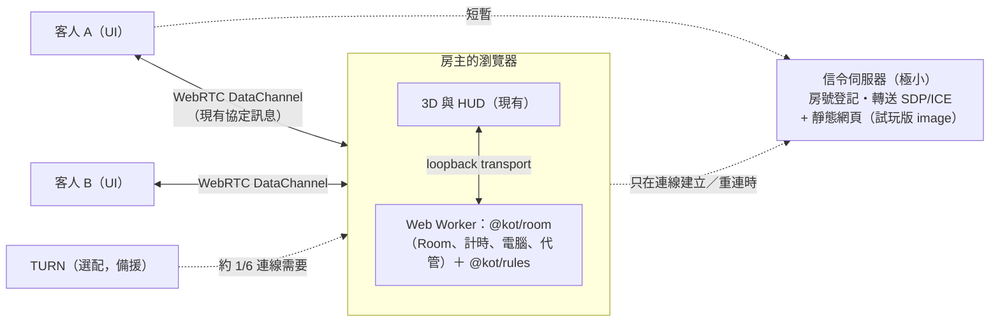

# ADR-0007：P2P（房主權威）架構與 M5 之後的重新規劃

- 狀態：**提議中（2026-11-11），等使用者確認後才開始實作**
- 取代：ADR-0002 的「伺服器權威、所有流量經過伺服器」（確認後才改狀態；規則引擎、協定、3D 都不受影響）
- 相關：ADR-0005（大廳、身分、計時）、[cloud-run-demo runbook](../runbooks/cloud-run-demo.md)

## 1. 背景

### 1.1 問題

試玩版（單一容器、Cloud Run）用完了免費額度。已知事實（來源見文末）：

- Cloud Run 免費額度：每月 180,000 vCPU 秒、360,000 GiB 秒、200 萬次請求，**外送流量 1 GiB 僅限北美**。
- **WebSocket 連線開著的期間，該執行個體視為處理請求中，持續計費**；單一連線最長 60 分鐘就被平台切斷。
- 我們的客戶端斷線會自動重連，所以「開著網頁就離開」的分頁會一直續約。**M4.14 已加上閒置踢除**（5 分鐘），這可能已經解決大部分試玩版的超量，但需要部署後看帳單才知道。

### 1.2 流量其實很小，成本在「連線時間」

沙盒模擬（4 人局約 130 步、6 人局約 200 步）：每步一個視角狀態約 1.5–1.9 KB（gzip 後約 0.55 KB）＋事件約 0.16 KB；卡牌目錄約 10 KB（gzip 4 KB）。**一整局對所有玩家合計約 1–2.5 MB。** 所以問題不是資料量，而是「為了轉送這點資料，伺服器必須整場陪著每一位玩家」。

### 1.3 使用者的新方向

1. 大部分流量與程式邏輯移到前端（P2P），伺服器只保留必要功能。
2. **不影響目前功能**。
3. 正式版必須把靜態網頁放到免費 CDN；**試玩版仍要「一個 demo image 就能部署」**。
4. 試玩版可能改放 Railway（免綁信用卡、從 Docker Hub 拉 image、額度用完被強制關閉而不是被扣款）。

## 2. 決策（提議）

**房主權威的星狀 P2P：** 建房的人（房主）的瀏覽器執行規則引擎與房間邏輯；其他玩家用 WebRTC DataChannel 連到房主，收發的**就是現有的協定訊息**（`@kot/protocol`，包含視角過濾後的狀態與事件）。伺服器退化成「信令＋靜態檔」。

### 2.1 為什麼是這個形狀

- **Room 本來就是可攜的。** `Room` 透過注入的 `Scheduler`、`Publisher`、`randomInt` 運作，沒有直接碰 Socket.IO；規則引擎是純函式。要搬的是「執行位置」，不是重寫。
- **協定不變。** 客人端的畫面層不需要知道訊息是從 Socket.IO 還是 DataChannel 來的；只換 transport。
- **伺服器權威模式可以保留**（同一個 `@kot/room` 跑在 Node），成本很低，且是「嚴格公平」場合的備援（見 §5）。

### 2.2 伺服器只剩什麼

| 功能              | 說明                                                                                          |
| ----------------- | --------------------------------------------------------------------------------------------- |
| 靜態網頁          | 試玩版：同一個 image 提供（現狀）；正式版：搬到 CDN（本來就必須）                             |
| 信令              | 房號登記（防重複、`MAX_ROOMS`）、轉送 SDP/ICE、每 IP 限流。**不碰遊戲資料，不知道誰在玩什麼** |
| TURN 憑證（選配） | 短效憑證需要機密金鑰，所以要一個極小的端點；TURN 本身用第三方                                 |
| 健康檢查          | 現有 `/healthz`                                                                               |

### 2.3 讓伺服器能「睡覺」：隨需信令

連線時間才是成本，所以信令連線**不應整場常駐**：

1. 大廳階段：房主保持信令連線（等客人加入，通常幾分鐘）。
2. 開局後：全員 P2P 連妥就**關掉信令連線**。
3. 有人掉線：房主重新開信令（重連視窗，例如 5 分鐘）；掉線的人輪詢（短 HTTP）直到房主在線，再走一次 SDP 交換。
4. 結果：一局只佔伺服器「大廳等待＋少數重連」的時間，而不是整場 × 全部玩家。伺服器沒人時可縮到 0（Cloud Run）或睡眠（Railway Serverless：約 5–10 分鐘沒有對外封包就睡）。

這是**設計目標，不是已驗證的數字**；第一版可以先「房主整場保持信令」（連線時間約為現在的 1/N），再優化成隨需。

### 2.4 不影響現有功能（對照表）

| 現有功能                        | P2P 後在哪裡                                     | 備註                                                            |
| ------------------------------- | ------------------------------------------------ | --------------------------------------------------------------- |
| 規則引擎、卡牌效果、重播        | 房主的 Worker                                    | 不變；客人不需要引擎（只需要 `describeEvent` 等顯示用函式）     |
| 大廳、準備、房主、開局          | 房主的 Worker                                    | `Room` 搬位置                                                   |
| 分享連結 `?room=CODE`           | 不變                                             | 客人用房號向信令找房主                                          |
| 電腦玩家（smartBot）            | 房主的 Worker                                    | 計算量在房主的瀏覽器；用 Worker 避免卡住畫面                    |
| 逾時代管、away、決策計時        | 房主的 Worker                                    | 瀏覽器背景分頁的計時器會被節流 → 用 Worker＋Wake Lock（見風險） |
| 重連（token）                   | 房主發 token；客人存 localStorage                | 同現在，只是簽發者從伺服器變房主                                |
| 12 隻怪獸隨機分配               | 房主                                             | `randomInt` 改用 Web Crypto                                     |
| 自備卡表（CSV）                 | 房主在本機載入，透過 DataChannel 傳給客人        | **更好**：我們不必在任何伺服器放第三方資料                      |
| 視角過濾（`redactState`）       | 房主對每位客人各算一份                           | 不變                                                            |
| 速率限制、`MAX_ROOMS`、連線上限 | 信令端                                           | 房主端另對客人訊息限流                                          |
| 閒置踢除（M4.14）               | 信令連線沿用；P2P 連線改由房主的「away」機制處理 |                                                                 |
| 3D 導演、特效、HUD              | 不變                                             |                                                                 |
| 負載測試 10,000 連線            | 改成「信令」與「房主瀏覽器」各自的容量目標       | 見 §6，目標要重訂                                               |

## 3. 信任模型（必須讓使用者知道的取捨）

房主的瀏覽器擁有完整狀態：**牌庫順序與骰子的亂數狀態都在房主手上。** 被竄改的房主客戶端可以偷看接下來的骰子或牌、或虛報結果。這是 P2P 無法避免的代價（要真正隱藏需要「心理撲克」等密碼學，不在範圍內）。

緩解（由輕到重，皆為後續里程碑，**不保證完全防作弊**）：

1. **誠實預設：** 房主自己的畫面也只用視角過濾後的資料；一般玩家不會改程式。
2. **種子共同產生（commit–reveal）：** 開局種子由所有玩家各貢獻一份亂數混合，房主無法「挑好種子」。
3. **賽後稽核：** 結束時房主公開種子與動作日誌，所有客人用規則引擎重播並比對結果；房主若虛報骰子或結果，會被發現（可偵測「竄改」，**偵測不到「偷看」**）。
4. **嚴格模式：** 保留伺服器權威模式（同一份 `@kot/room`），要求公平的場合用它。

這是朋友之間遊玩的信任等級，與「排名賽」不同；README 與房間畫面需要明講。

## 4. 替代方案

| 方案                                                | 優點                   | 不採用／暫不採用的原因                                                                                   |
| --------------------------------------------------- | ---------------------- | -------------------------------------------------------------------------------------------------------- |
| A. 現狀＋閒置踢除（M4.14）                          | 已完成、零風險         | 仍是「每位玩家整場佔一條伺服器連線」；規模大時成本線性成長。**可能已足夠撐試玩版**，但不能解決正式版成本 |
| B. 每位玩家都跑引擎（鎖步）                         | 沒有單點               | 隱藏資訊（牌庫、亂數）無法保密；需要複雜的密碼協定                                                       |
| C. 只做靜態搬家（CDN）                              | 立刻降低請求與流量     | 不減少 WebSocket 連線時間；仍然必做（正式版）                                                            |
| D. Serverless 信令（Cloudflare Durable Objects 等） | 正式版可免維運         | **免費額度尚未查證**（見 §8）；列為正式版選項，試玩版維持單一 image                                      |
| E. 公開信令（Trystero：Nostr／BitTorrent／MQTT）    | 完全不需要自己的伺服器 | 官方說明公開中繼**不保證高可用**；可作為可插拔的備用實作                                                 |

## 5. 里程碑（取代原本的 M5／M6）

大小：S＝數天、M＝約 1–2 週、L＝2 週以上（粗估，未含審查）。

| 里程碑 | 內容                                                                                                                                                                                              | 大小 | 沙盒可驗證                       | 驗收                                                                                                |
| ------ | ------------------------------------------------------------------------------------------------------------------------------------------------------------------------------------------------- | ---- | -------------------------------- | --------------------------------------------------------------------------------------------------- |
| M5     | **可攜核心＋離線對電腦**：抽出 `packages/room`（Room、計時、電腦、代管，去掉 `node:crypto`）；`packages/cardsets` 拆成純解析與檔案載入；`Transport` 介面（Socket.IO／Loopback）；Worker 執行 Room | L    | 全部（單元、整合、Playwright）   | 既有測試全數通過；**不連伺服器就能「房主＋電腦」玩完整局**（`?offline=1`）；伺服器模式行為不變      |
| M6     | **WebRTC＋極小信令**：信令協定（登記、加入、SDP／ICE 轉送、限流）；`WebRtcTransport`（房主端／客人端）；大廳流程、分享連結走信令；訊息分段（>16 KB）；token 由房主簽發                            | L    | 多分頁 WebRTC（本機回圈）        | 兩到六個瀏覽器分頁完成整局；分享連結可加入；信令只轉送 SDP／ICE（以測試確認不經手遊戲訊息）         |
| M7     | **房主韌性與連線品質**：房主重整自動接回（動作日誌存 IndexedDB）；客人斷線重連；房主離線的暫停／結束規則；背景分頁對策（Worker 計時、Wake Lock）；TURN 備援（憑證端點）；連線品質指示             | M    | 模擬斷線／延遲（可注入的假傳輸） | 房主重整後同一局繼續；客人掉線重連接回座位；TURN 流程在可控環境驗證（真實 NAT／電信網路**未實測**） |
| M8     | **信任與稽核**：種子共同產生、賽後重播稽核、畫面上的信任說明；（選配）嚴格模式切換                                                                                                                | M    | 全部（純邏輯）                   | 竄改結果的房主在稽核時被偵測；文件明講「偷看」無法防                                                |
| M9     | **上線**：試玩 image（信令＋靜態，一個 image；Cloud Run／Railway 皆可）、正式版靜態搬 CDN、信令限流與每 IP 限制、Snyk、CI、事件日誌（改為房主本機）、**重訂的容量目標與負載測試**                 | M    | 信令負載測試（沙盒 Linux）       | 數字以實測為準；平台實際計費行為需部署後觀察                                                        |
| M10    | 選配（原 M6 剩餘）：觀戰（房主多連幾條只讀 DataChannel，需頻寬上限）、Duel 模式、手機版面、其他場地主題、（研究）房主轉移                                                                         | —    | —                                | 另行規劃                                                                                            |

原 M5 的「事件日誌入 PostgreSQL」不再是必要：P2P 下日誌存在房主本機（M7）。伺服器模式若要保留持久化，列入 M9 的選配。

## 5.1 試玩版與部署（Cloud Run／Railway）

- 原則：**image 不含平台專屬程式**，只靠 `PORT` 等環境變數；Cloud Run 與 Railway 用同一個 image。
- Railway 官方文件（2026-11 查證）：Free 方案每月 $1 額度（每服務上限 1 vCPU／0.5 GB）；Trial 一次性 $5、最多 30 天；額度用完**工作負載停止**；出站流量 $0.05／GB 也從額度扣；Serverless 在約 5–10 分鐘沒有對外封包後睡眠。**「免綁卡」與「從 Docker Hub 拉 image」文件沒有明確寫，需註冊時確認**；無法確認的是 WebSocket 連線是否阻止睡眠（文件未說明）。
- 估算（**我的算術，未實測**）：Railway 記憶體約 $10／GB 月；一個閒置 Node 程序約 100 MB 就接近每月 $1 額度。所以「常駐 WebSocket 的現行架構」在 Railway 免費額度內撐不久；P2P＋隨需信令讓服務有機會睡覺，才是它適合 P2P 的原因。
- 試玩版 image 維持 `docker build` 一次完成（`make demo-image`）。

## 6. 容量目標（重訂）

原目標「同時 10,000 人經過同一台伺服器」只適用伺服器模式。P2P 模式要量的是：

1. **信令**：每秒新建房／加入次數、同時登記的房數（房主常駐信令時，連線數＝房間數）。
2. **房主瀏覽器**：6 人局（含 smartBot）在基準機（2014 MBP 13"）上的 CPU 與 FPS。
3. **每局流量**：模型估計 1–2.5 MB／局（見 §1.2），需用實際 DataChannel 量測確認。

## 7. 風險與未知

| 風險                               | 說明                                                                                            | 對策／驗證                                            |
| ---------------------------------- | ----------------------------------------------------------------------------------------------- | ----------------------------------------------------- |
| 無法直連                           | Chrome 資料：已連線的 P2P 通話中約 17.7% 經由 TURN 中繼（通話資料，不是遊戲資料，僅作量級參考） | M7 加 TURN 備援；試玩版第一版可明講「部分網路連不上」 |
| 房主瀏覽器計時被節流               | 背景分頁計時器會被延後，影響逾時與電腦出手                                                      | Worker 計時、Wake Lock；**要實測**；手機不建議當房主  |
| 房主掉線＝這局結束（沒有房主轉移） | 房主轉移需要把完整狀態交給別人，等於把隱藏資訊交出去                                            | M7 做「房主重整接回」；轉移列入 M10 研究              |
| 手機／行動網路                     | 電信網路常為 CGNAT，直連成功率較低（未量測）                                                    | TURN；手機優先當客人                                  |
| 打包大小                           | 客人端現在就會帶規則引擎（顯示事件用）；房主端多帶 Room 與 smartBot                             | 房主程式碼延遲載入（動態 import）                     |
| 兩套傳輸要維護                     | Socket.IO 模式與 WebRTC 模式                                                                    | 共用 `@kot/room`，只有 transport 不同                 |
| 信任模型被誤解                     | 玩家以為「不可能作弊」                                                                          | §3 與 UI 文案；M8                                     |

## 8. 尚未查證（不寫成事實）

- Cloudflare TURN／Durable Objects 的免費額度與是否需要信用卡（本次查證時頁面無法取得）。
- Railway Free 方案是否需要信用卡、WebSocket 是否阻止睡眠、Docker Hub 部署細節。
- Chrome 對「有 WebRTC 連線的背景分頁」的計時器節流是否豁免（需實測）。
- 真實網路下的直連成功率（需要多個網路環境）。

## 9. 需要使用者決定

1. **保留伺服器權威模式**（同一份 `@kot/room`，成本低）還是 P2P 穩定後移除？**建議保留到 M9 再決定。**
2. **房主固定，房主離線＝暫停後結束**（M7 支援房主重整接回，不做房主轉移）可以嗎？
3. **TURN**：第一版試玩不含 TURN（部分玩家連不上）？還是要在 M7 註冊 TURN 服務（可能需要信用卡，待查證）？
4. **房主限定桌面瀏覽器**、手機只能當客人，可以嗎？
5. **信任等級**：朋友間遊玩（M8 提供稽核即可）是否足夠？
6. 是否同意把 **M5「可攜核心＋離線對電腦」** 當作第一步（它本身就有價值：不用連線就能玩，也是 P2P 的前置）。

## 來源

- Cloud Run 計價與免費額度：<https://cloud.google.com/run/pricing>
- Cloud Run WebSocket（連線期間視為使用中、最長 60 分鐘、可重連）：<https://docs.cloud.google.com/run/docs/triggering/websockets>
- Railway 方案與額度：<https://docs.railway.com/pricing/plans>；試用：<https://docs.railway.com/pricing/free-trial>；Serverless：<https://docs.railway.com/deployments/serverless>；費率（第三方整理）：<https://temps.sh/blog/railway-pricing-2026>
- TURN 使用比例（Chrome 資料）：<https://medium.com/@fippo/what-kind-of-turn-server-is-being-used-d67dbfc2ff5d>
- Trystero（無伺服器信令策略與限制）：<https://unpkg.com/trystero@0.21.6/README.md>
- PeerServer（自架信令）：<https://peerjs.com/peerserver.html>
- 本專案的流量量測：沙盒模擬（`packages/rules` 的對局，smartBot 對 greedyBot，含原創卡組），2026-11-11。
