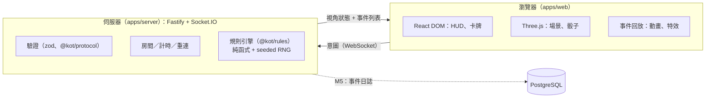
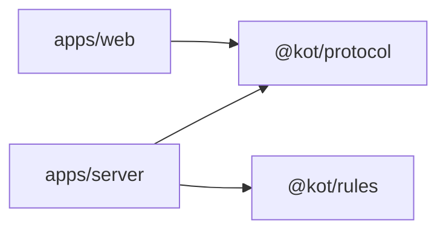

# 架構概觀

## 系統

- **客戶端只送意圖**（保留哪些骰子、購買哪張卡），伺服器驗證並擲骰，再廣播每位玩家視角的狀態與事件列表。
- **規則引擎**是 `reduce(state, action) → { state, events }` 的純函式；RNG 狀態在 state 內，因此「初始 seed + action log」可完整重放。
- **3D 演出是事件的回放**：動畫不影響遊戲狀態，可跳過、加速或在低畫質下簡化。

詳見 [ADR-0002](adr/0002-server-authoritative-socketio.md)、[ADR-0003](adr/0003-3d-scope-and-art-direction.md)。

## 套件依賴方向

`@kot/rules` 與 `@kot/protocol` 不依賴任何 app，也不互相依賴（M1 起 protocol 會引用 rules 的型別，屆時再審視）。

## 里程碑與狀態

| 里程碑 | 內容                                                                                 | 狀態                                                         |
| ------ | ------------------------------------------------------------------------------------ | ------------------------------------------------------------ |
| M0     | 骨架、環境、文件、CI                                                                 | **完成**（沙盒與使用者實測通過；CI 尚未在 GitHub 上執行）    |
| M1     | 規則引擎（無卡牌）：擲骰、結算、東京市／灣、讓位、淘汰、勝負（含 R-END）、支援多勝者 | **已實作並在沙盒測試通過**（分支 m1/rules-engine，尚未合併） |
| M2     | 連線與簡易 UI：大廳、房間、重連、計時                                                | 未開始                                                       |
| M3     | 卡牌系統（可抽換卡組）：hook 框架、效果實作                                          | 未開始，需要使用者提供官方卡表                               |
| M4     | 美術與 3D：風格化 UI、場景、破壞與打擊感、低畫質模式                                 | 未開始                                                       |
| M5     | 品質與上線：事件日誌、負載測試（10,000 連線）、Snyk、部署                            | 未開始                                                       |
| M6     | 選配：機器人、觀戰、Duel 模式、手機                                                  | 未開始                                                       |

## M0 驗證狀態（2026-11-06）

| 項目                           | 狀態                                                    | 說明                                                                            |
| ------------------------------ | ------------------------------------------------------- | ------------------------------------------------------------------------------- |
| lint／typecheck／test／build   | **Tested（沙盒＋使用者 Mac）**                          | `pnpm run check` 全部通過，35 個測試                                            |
| 本機 `pnpm install`（Big Sur） | **Tested（使用者）**                                    | esbuild 0.25.12                                                                 |
| `docker compose up --build`    | **Tested（使用者，Docker 20.10.17 / Compose v2.10.2）** | 三個服務啟動，`/healthz` 回 ok                                                  |
| 正式 server 映像               | **Tested（使用者）**                                    | 建置、啟動、優雅關閉；映像內沒有套件管理器                                      |
| WebGL2                         | **Tested（使用者）**                                    | 支援                                                                            |
| 依賴漏洞                       | **Tested（使用者）**                                    | `snyk test --all-projects`、`snyk container test`、`pnpm audit --prod` 皆無漏洞 |
| GitHub Actions CI              | **未實測**                                              | 需要在 GitHub 上首次執行才知道                                                  |

## 容量目標

同時 10,000 人在線（使用者指定）。MVP 單一實例、記憶體房間狀態；**尚未驗證**能否達標，M5 以 Linux 負載測試量測並決定是否分片。理由與擴展路徑見 ADR-0002。
