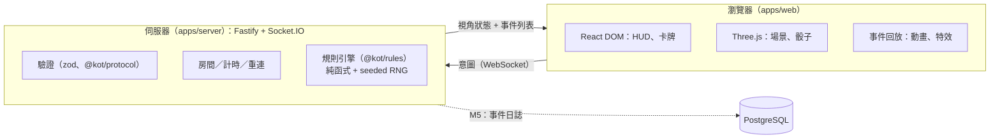
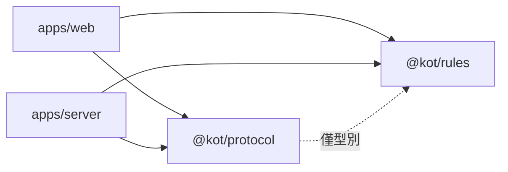
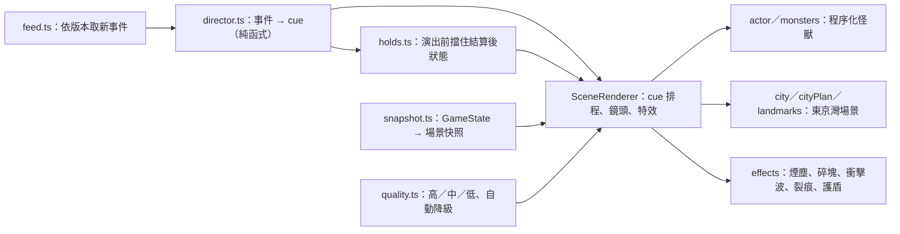

# 架構概觀

## 系統

- **客戶端只送意圖**（保留哪些骰子、購買哪張卡），伺服器驗證並擲骰，再廣播每位玩家視角的狀態與事件列表。
- **規則引擎**是 `reduce(state, action) → { state, events }` 的純函式；RNG 狀態在 state 內，因此「初始 seed + action log」可完整重放。
- **3D 演出是事件的回放**：動畫不影響遊戲狀態，可跳過、加速或在低畫質下簡化。

詳見 [ADR-0002](adr/0002-server-authoritative-socketio.md)、[ADR-0003](adr/0003-3d-scope-and-art-direction.md)、[ADR-0005](adr/0005-lobby-sessions-and-timers.md)（M2：身分、房間、計時）、[ADR-0006](adr/0006-card-engine.md)（M3：卡牌引擎、隱藏資訊、協定 v3）。

## 套件依賴方向

`@kot/rules` 與 `@kot/protocol` 不依賴任何 app。`@kot/protocol` 只以型別引用 `@kot/rules`（`GameState`、`GameEvent`），沒有執行期依賴。

## 里程碑與狀態

| 里程碑 | 內容                                                                                                                                                          | 狀態                                                                                                                                        |
| ------ | ------------------------------------------------------------------------------------------------------------------------------------------------------------- | ------------------------------------------------------------------------------------------------------------------------------------------- |
| M0     | 骨架、環境、文件、CI                                                                                                                                          | **完成並已合併**（PR #1；沙盒與使用者 Mac 實測通過）                                                                                        |
| M1     | 規則引擎（無卡牌）：擲骰、結算、東京市／灣、讓位、淘汰、勝負（含 R-END）、支援多勝者                                                                          | **完成並已合併**（PR #2；沙盒與使用者 Mac 實測通過）                                                                                        |
| M2     | 連線與簡易 UI：大廳、房間、重連、計時                                                                                                                         | **完成並已合併**（PR #3；沙盒、使用者 Mac 與 CI 通過）                                                                                      |
| M3     | 卡牌系統（可抽換卡組）：商店、買牌、約 60 種效果、提示、復活／搭檔、協定 v3                                                                                   | **完成並已合併**（PR #4；OQ-C 詮釋已確認並實作，僅 C2「他人回合空檔使用」未做）                                                             |
| M4     | 美術與 3D：風格化 UI、場景、破壞與打擊感、低畫質模式                                                                                                          | **實作完成**（分支 m4/scene；沙盒測試通過；待使用者 Mac 實測與 PR 合併）                                                                    |
| M4.5   | 遊戲 HUD：3D 區內完整操作、卡牌／骰子／勝利條件說明                                                                                                           | **實作完成**（分支 m4/game-hud，疊在 m4/scene 上；沙盒測試通過；待使用者實測）                                                              |
| M4.6   | 地圖不被 HUD 遮住（並排／固定地圖版面）、拖曳與縮放地圖                                                                                                       | **實作完成**（分支 m4/map-view，疊在 m4/game-hud 上；沙盒測試通過；待使用者實測）                                                           |
| M4.7   | 鏡頭自動跟隨行動中的怪獸                                                                                                                                      | **實作完成**（分支 m4/camera-follow，疊在 m4/map-view 上；沙盒測試通過；待使用者實測）                                                      |
| M4.14  | 閒置踢除：太久沒有操作的連線被中斷（協定 v5：`client:active`、`idle_timeout`）；一鍵重新連線                                                                  | **實作完成**（沙盒測試與 Playwright 驗證；Cloud Run 上的實際效果未實測）                                                                    |
| M4.13  | 電腦玩家：房主加入／移除電腦、伺服器用 `smartBot` 出手、不受代管限制（協定 v4）                                                                               | **實作完成**（分支 feat/bots，疊在 feat/share-link 上；沙盒測試與 Playwright 驗證；真機未實測）                                             |
| M4.12  | 房間邀請連結（`?room=房號`，輸入暱稱自動加入）                                                                                                                | **實作完成**（分支 feat/share-link；沙盒 Playwright 雙人驗證；真機／手機分享未實測）                                                        |
| M4.11  | 單一容器的試玩版 image（Cloud Run）：伺服器供網頁、記憶體、房間 5／連線 30 上限                                                                               | **實作完成**（分支 demo/cloud-run；沙盒以 node 驗證；image 建置與部署未實測）                                                               |
| M4.10  | 12 種怪獸造型＋12 種招式；每場開局伺服器隨機分配造型（`PlayerInfo.monster`）                                                                                  | **實作完成**（分支 m4/monster-roster，疊在 m4/follow-fix 上；沙盒測試通過；待使用者實測）                                                   |
| M4.9   | 怪獸站位避開大型建物（障礙盒檢查）、6 種怪獸招式特效（可關閉）                                                                                                | **實作完成**（分支 m4/monster-fx，疊在 m4/notices 上；沙盒測試通過；待使用者實測）                                                          |
| M4.8   | 提示（商店可買、重大事件）、離開商店確認、鏡頭開關圖示                                                                                                        | **實作完成**（分支 m4/notices，疊在 m4/camera-follow 上；沙盒測試通過；待使用者實測）                                                       |
| M5     | 可攜核心＋離線對電腦：`packages/room`（Room、閘道、計時、電腦、代管，不依賴 node:*）、`@kot/cardsets/pure`、客戶端連線抽象（Socket.IO／Worker）、`?offline=1` | **實作完成**（沙盒測試與 Playwright 驗證；基準機與真實手機未實測）；見 [ADR-0007](adr/0007-p2p-host-authoritative.md)                       |
| M6     | 房主權威＋自家 WebSocket 中繼（取代 TURN）：`/relay` 房號登記與轉發、`HostBridge`／`GuestEndpoint`、`?mode=p2p`                                               | **實作完成**（沙盒測試與 Playwright 驗證；真實網路、手機、Docker 未實測）；見 [ADR-0007](adr/0007-p2p-host-authoritative.md)                |
| M7     | WebRTC 背景升級：直連成功後客人關閉中繼連線，對局中所有人都直連時房主「停泊」（不佔伺服器連線）；直連中斷回中繼接回座位                                       | **實作完成**（沙盒測試與真實 Chromium 兩分頁驗證；真實 NAT、手機、Docker 未實測）；見 [ADR-0007](adr/0007-p2p-host-authoritative.md)        |
| M8     | 韌性：房主重整接回（動作日誌存 IndexedDB、重放還原）、客人重整接回、完整重送、Wake Lock、連線品質指示                                                         | **實作完成**（沙盒測試與真實 Chromium 驗證；真機、手機背景化、跨網路未實測）；見 [ADR-0007](adr/0007-p2p-host-authoritative.md)             |
| M9     | 房主轉移：後備房主（複本增量同步）、故障接手（依名次錯開）、計畫性交接、epoch 與舊房主降級、確定性故障注入測試                                                | **實作完成**（沙盒確定性測試與真實 Chromium 三分頁驗證；真機、跨網路、手機背景化未實測）；見 [ADR-0007](adr/0007-p2p-host-authoritative.md) |
| M10    | 信任與稽核：種子共同產生（commit–reveal）、賽後重播稽核（背景 Worker）、畫面上的信任說明                                                                      | **實作完成**（沙盒確定性測試與真實 Chromium 兩分頁整局驗證；真機、跨網路未實測）；見 [ADR-0007](adr/0007-p2p-host-authoritative.md)         |
| M11    | **（計畫中）** 上線：試玩 image（Cloud Run／Railway）、靜態搬 CDN、限流、Snyk、容量目標重訂與負載測試                                                         | 未開始                                                                                                                                      |
| M12    | **（計畫中，選配）** 觀戰、Duel 模式、手機版面、其他場地主題                                                                                                  | 未開始                                                                                                                                      |

## M0 驗證狀態（2026-11-06）

| 項目                           | 狀態                                                    | 說明                                                                            |
| ------------------------------ | ------------------------------------------------------- | ------------------------------------------------------------------------------- |
| lint／typecheck／test／build   | **Tested（沙盒＋使用者 Mac）**                          | `pnpm run check` 全部通過，35 個測試                                            |
| 本機 `pnpm install`（Big Sur） | **Tested（使用者）**                                    | esbuild 0.25.12                                                                 |
| `docker compose up --build`    | **Tested（使用者，Docker 20.10.17 / Compose v2.10.2）** | 三個服務啟動，`/healthz` 回 ok                                                  |
| 正式 server 映像               | **Tested（使用者）**                                    | 建置、啟動、優雅關閉；映像內沒有套件管理器                                      |
| WebGL2                         | **Tested（使用者）**                                    | 支援                                                                            |
| 依賴漏洞                       | **Tested（使用者）**                                    | `snyk test --all-projects`、`snyk container test`、`pnpm audit --prod` 皆無漏洞 |
| GitHub Actions CI              | **Tested（使用者，M2 起）**                             | 使用者回報 M2 的 CI 跑過；M0／M1 當時未個別確認                                 |

## M1 驗證狀態（2026-11-06）

| 項目                                            | 狀態                           | 說明                                                         |
| ----------------------------------------------- | ------------------------------ | ------------------------------------------------------------ |
| `pnpm run check`（含 148 個規則引擎測試）       | **Tested（沙盒＋使用者 Mac）** | 格式、lint、typecheck、全部測試、建置通過                    |
| `snyk test --all-projects`、`pnpm audit --prod` | **Tested（使用者）**           | 5 個專案無漏洞；`@kot/rules` 新增的 fast-check 只是 dev 依賴 |
| `snyk container test kot-server`                | **Tested（使用者）**           | 19 個 Alpine 套件無漏洞；映像內沒有套件管理器                |
| 獨立審查                                        | **Reviewed（子代理，唯讀）**   | 沒有違反規則編號的缺陷；防禦性建議已修                       |
| GitHub Actions CI                               | **未個別確認**                 | 使用者回報 M2 的 CI 跑過                                     |

## M2 驗證狀態（2026-11-07）

| 項目                                                             | 狀態                             | 說明                                     |
| ---------------------------------------------------------------- | -------------------------------- | ---------------------------------------- |
| `pnpm run check`（規則 151、協定 26、網頁 18、伺服器 64 個測試） | **Tested（沙盒＋使用者 Mac）**   | 全部通過                                 |
| 雙瀏覽器對局、重新整理接回                                       | **Tested（沙盒 Playwright）**    | 建房、加入、準備、開始、打完一局         |
| 對局、重連、逾時代打、斷線                                       | **Tested（使用者，真實瀏覽器）** | 皆符合預期                               |
| 獨立審查                                                         | **Reviewed（子代理，唯讀）**     | 計時可被重連拖延、大廳離線佔位等問題已修 |
| 握手限流、每 IP 限制                                             | **未做（M5）**                   | 見 ADR-0005 的已知缺口                   |
| Docker 內的 M2 對局                                              | **未實測**                       | 沙盒沒有 Docker                          |
| GitHub Actions CI                                                | **Tested（使用者）**             | M2 的 PR 通過                            |

## M3 驗證狀態（2026-11-08）

| 項目                                                                           | 狀態                          | 說明                                                          |
| ------------------------------------------------------------------------------ | ----------------------------- | ------------------------------------------------------------- |
| `pnpm run check`（規則 274、卡牌組 19、協定 29、網頁 26、伺服器 76 個測試）    | **Tested（沙盒）**            | 格式、lint、typecheck、測試、建置通過；使用者 Mac 尚未跑      |
| 全部效果的整場模擬（不變量、重放一致）、含使用者自備 77 張卡表的機器人整場模擬 | **Tested（沙盒）**            | 77 張全部成功匯入並對應效果                                   |
| 協定涵蓋度：引擎的每種合法動作都通過協定驗證，且房間可打完整局                 | **Tested（沙盒）**            |                                                               |
| 雙瀏覽器對局（買牌、提示、事件日誌顯示卡名）                                   | **Tested（沙盒 Playwright）** | 以建置產物與使用者自備卡組各跑一次                            |
| 獨立審查                                                                       | **Reviewed（子代理，唯讀）**  | 找到 7 項確認缺陷，已修正並補回歸測試（見 ADR-0006）          |
| Docker（掛載 card-sets、映像只含原創卡組）                                     | **未實測**                    | 沙盒沒有 Docker；請依 runbook 在 Mac 驗證                     |
| 詮釋 OQ-C1…C9                                                                  | **已確認（使用者）**          | 已實作，僅 C2「他人回合空檔使用」未做；見 rules-spec-cards.md |

## M4 驗證狀態（2026-11-09）

| 項目                                                                        | 狀態                          | 說明                                                                                                                                             |
| --------------------------------------------------------------------------- | ----------------------------- | ------------------------------------------------------------------------------------------------------------------------------------------------ |
| `pnpm run check`（規則 274、卡牌組 19、協定 29、網頁 86、伺服器 76 個測試） | **Tested（沙盒）**            | 格式、lint、typecheck、測試、建置通過；使用者 Mac 尚未跑                                                                                         |
| 雙瀏覽器對局到結束（建置產物）                                              | **Tested（沙盒 Playwright）** | 無 console 錯誤；結束後場景標籤的 HP／VP 與 DOM 表格一致、動畫佇列排空                                                                           |
| 繪製量（軟體算圖統計）                                                      | **Tested（沙盒）**            | 高：約 82 draw calls／5.2 萬三角面；中：57／2.9 萬（預算 <100／<10 萬）                                                                          |
| **FPS（≥30，基準機）**                                                      | **體感 OK，無數字**           | 使用者回報體感 OK（MacBook Pro 2015／Chrome 138）；沒有實際 FPS 量測，≥30 的量化目標仍未確認                                                     |
| 獨立審查                                                                    | **Reviewed（子代理，唯讀）**  | 13 項發現，高／中／低共 11 項已修（受傷保留未解除、事件與快照順序、canvas 重用等）；演出時間縮放造成撞擊與出拳不同步（輕微）、每幀小量配置未處理 |
| 怪獸造型                                                                    | **原創、程序化**              | 參考圖只用於比例與風格，不複製任何既有角色；第三方 GLB 資源庫（Polyfork）無法從沙盒取得、授權未確認，未使用                                      |

## M10 驗證狀態（2026-11-14）

**做了什麼：** 房主模式的對局不再由房主單方面抽種子；局後每位客人都能用規則引擎重放整場、核對房主給過的每一個畫面。

- **種子共同產生（`packages/room/src/audit/ceremony.ts`）：** 房主（或房間的遊戲房主）按「開始」時，中繼房主攔下 `room:start`：①挑 `r_h` 並公布承諾 `c = SHA256(domain|房號|次數|r_h)`（線上訊息 `seed-begin`）；②每位已握手的真人客人挑 `r_i`，**只回給房主**（`seed-part`）；全部回來或 5 秒逾時；③種子＝`SHA256(domain|房號|次數|r_h|id=r_i…)` 取前 128 位元（依玩家 id 排序，與抵達順序無關）；④把種子交給房間開局（`newSeed` 覆寫），並把儀式紀錄（次數、`r_h`、承諾、各人貢獻、缺席者）放進 `RoomReplica.ceremony`——所以存檔、複本同步與 M9 接手都自然帶著它。房間裡沒有其他真人（只有房主＋電腦）時不做儀式。這兩種訊息不會出現在頁面（端點層攔截）。
- **為什麼貢獻不廣播：** 種子一旦人人算得出，牌庫與骰子就全部公開、遊戲沒有隱藏資訊了。所以貢獻只給房主；客人事後靠房主揭露的紀錄驗證自己的貢獻有被算進去。房主**不能**選種子（他在看到客人貢獻前已承諾 `r_h`），只能重來——每次重來都要再向所有客人要一次，且次數寫進紀錄。
- **局後稽核（`audit.ts`、`guestAuditor.ts`）：** `GuestAuditor` 在對局中記帳：每個收到的 `game:update` 取正規化 JSON（鍵排序）的 SHA-256 摘要，依 `state.version` 記錄（版本倒退＝房主換人後從複本繼續，捨棄之後的版本）；同時記下開局前收到的承諾與自己送出的貢獻（只在記憶體）。複本顯示 `phase = over` 後等 0.4 秒（讓最後的畫面也進來），把「房主給的複本＋我的紀錄」交給驗證函式（網頁：`audit.worker.ts`，用完即丟；測試：同步呼叫 `auditGame`）。檢查六項：卡牌組內容雜湊一致、承諾對得上（與我當時收到的也一致）、我的貢獻有被算進去、種子由此算出、動作日誌逐步重放合規且對局結束、**我看過的每個版本的畫面摘要都等於「重放的該版本狀態經 `redactState(我的座位)`」**。任何一項失敗＝未通過並列出原因；沒有儀式（舊版房主、關閉儀式）或我沒參與則該項「略過」並在畫面說明。
- **畫面：** 房主模式橫幅下常駐可展開的「關於公平與信任」（偷看無法阻止、信任等級＝朋友之間、稽核是留證據、嚴格防作弊請用伺服器模式）；局後客人看到稽核結果，房主看到「每位客人各自稽核」的提示。
- **沒有做：** 複本／IndexedDB 的 AES-GCM 加密遮蔽（ADR §3.1 選配）。理由：後備房主接手時金鑰必須在其瀏覽器內，頁面主執行緒本來就收得到複本，只擋得住「隨手開網路面板／翻 IndexedDB」；且 Web Crypto `subtle` 只在安全連線可用，區網 http 要有另一條不加密路徑。以「不做、文件明講」處理。引擎只在 Worker、種子不送一般客戶端也不寫 log（M5 起如此）。

| 項目                                                                                    | 狀態                           | 說明                                                                                                                                                                                                                                                                                                                                                                                                                          |
| --------------------------------------------------------------------------------------- | ------------------------------ | ----------------------------------------------------------------------------------------------------------------------------------------------------------------------------------------------------------------------------------------------------------------------------------------------------------------------------------------------------------------------------------------------------------------------------- |
| 承諾／混種子／驗證儀式（單元）                                                          | **Tested**                     | 承諾綁定房號與次數；貢獻順序無關；格式錯誤的貢獻被丟掉並列入缺席；竄改種子、秘密、承諾、我的貢獻各自被抓到；我沒參與時略過而不是失敗                                                                                                                                                                                                                                                                                          |
| 稽核核心（單元，電腦打完整局產生真實日誌）                                              | **Tested**                     | 誠實全過；畫面被改（血量）→ observed 失敗；日誌被截短／竄改；種子不是儀式算出的；卡牌組不符；旁觀者視角；版本倒退的記錄器                                                                                                                                                                                                                                                                                                     |
| **確定性整合測試**（記憶體中繼＋每節點假時鐘，真實 Room／HostBridge／RoleEndpoint）     | **Tested**                     | 誠實房主：複本帶儀式、種子可由紀錄重算、兩位客人全項通過且比對了每個版本；頁面看不到 `seed-begin`／`seed-part`，也看不到種子、房主秘密、別人的貢獻；不回應的客人→等 5 秒後開局並列入缺席；房主＋電腦不做儀式；關閉儀式→種子三項略過其餘通過；房主偷改記憶體狀態→重放時動作不合規而被抓；房主只對一位客人謊報畫面（日誌誠實）→被騙者 observed 失敗、另一位通過；房主消失、客人接手後，新房主複本仍帶儀式、沒接手的客人稽核通過 |
| **真實 Chromium 兩分頁**（房主＋1 客人，純中繼）                                        | **Tested（Playwright，局部）** | 按「開始」約 0.15–0.24 秒開局（儀式往返）；打完整局（2 人，43 個動作）後客人畫面顯示「✅ 稽核通過：重放整場 43 個動作，44 個畫面全部一致，種子由房主與玩家共同產生」，房主看到各客人各自稽核的提示。4 人局（房主＋2 客人＋電腦）在 280 秒內沒打完（離線座位靠逾時代打太慢），只驗證到開局。**真實瀏覽器中沒有跑「房主說謊」的案例**（Worker 內的狀態無法從頁面竄改）；偵測由上列確定性測試涵蓋                                |
| `pnpm run check`（規則 283、協定 29、卡牌組 19、房間 136、網頁 198、伺服器 125 個測試） | **Tested（沙盒）**             | 稽核 Worker 獨立打包（約 159 KB，只在局後載入），主 bundle 不受影響                                                                                                                                                                                                                                                                                                                                                           |
| 真機、跨網路、Safari／Firefox、手機背景化下的稽核                                       | **未實測**                     | 稽核在客人的背景 Worker 執行，低階手機上重放約百步的耗時未量                                                                                                                                                                                                                                                                                                                                                                  |
| **已知限制**                                                                            | 風險                           | **偷看無法阻止**（客人是後備，持有種子與日誌）；稽核只證明「房主給過我的畫面與規則一致」，客人之間不互相驗證；只重放「對局結束」的複本（中途離開、房間被關的局沒有稽核）；重新整理過的客人沒有儀式記錄；房主若在儀式中途有人加入，晚到的人不在種子裡；房主可重來（次數遞增並寫進紀錄，客人只在稽核時看到最終次數，看不到「被重來過幾次」）；舊版客人使儀式多等 5 秒                                                           |
| 獨立審查                                                                                | **未做**                       |                                                                                                                                                                                                                                                                                                                                                                                                                               |

## M9 驗證狀態（2026-11-14）

**做了什麼：** 房主不見（關分頁、斷網、當機）時，房間不再結束，而是由後備房主接手；房主也可以主動把房主交給別人。

- **後備與複本：** 每位真人客人都是後備。房主持續把房間複本（成員、種子、設定、動作日誌）**增量**推給每位後備（`ReplicaSync`，每批 ≤100 筆；後備重新連上時整份重送；有缺口時後備要求重送）。後備順序＝直連者優先、再依加入順序。複本只放在後備的記憶體，**後備分頁重新整理就失去複本**（仍可用 token 以客人身分接回）。
- **接手金鑰：** 每位玩家一把 128 位元金鑰，只傳給本人；**伺服器只存雜湊與順序**，所以伺服器與其他客人都無法冒充接手。
- **故障接手（協定 v3：`relay:succession`／`relay:takeover`）：** 房主連線中斷後，第 k 順位等待 10 秒＋(k−1)×3 秒才可出示金鑰（**以伺服器時鐘裁決**，太早回 `too_early` 與 `retryInMs`；房主還在回 `host_online`）。成功＝發新房主金鑰、epoch＋1、清空順序、舊金鑰列入「已退休」；舊房主之後回來只會得到 `superseded`，並**降級成客人**（丟掉本機房間，以原 token 重新加入新房主的房間）。接手方還原複本後，所有客人收到連線重開並以原 token 接回座位，對局從複本狀態繼續（複本可能落後最後幾步，客人畫面倒退，沿用 M8 的版本倒退處理）。房間在房主消失後保留到「最後一位後備的接手時間＋10 秒」，沒人接手才關閉。
- **計畫性交接（`relay:handover`）：** 房主按「交給 ○○」→ 先推最新複本→向伺服器登記指定的接手者（30 秒內有效）→ 對方立刻接手（不必等寬限期）→ 原房主降級。失敗（對方離線、逾時）時原房主繼續。**沒有做的：** 分頁隱藏／手機背景化時自動交接（不可靠且容易誤觸，改為手動按鈕）。
- **角色切換端點（`RoleEndpoint`）：** 頁面永遠只連一個端點；背後在「客人（含後備狀態機）」與「房主（Worker）」之間切換，頁面只看到「連線中斷→重新連上」並用 token 重新握手。UI 顯示「你是房主／你是客人，第 N 順位後備房主」，角色改變時提示，房主可交接。
- **同時修正：** 伺服器 Socket.IO `pingInterval` 8 秒／`pingTimeout` 6 秒（更快發現房主斷線）；後備順序不以遊戲內房主座位（`hostId`）排除（降級回來的原房主也是後備）；Worker 啟動完成前先到的控制訊息改為排隊（否則 M8 房主重整會卡空白，真實瀏覽器驗證抓到）。

| 項目                                                                                                | 狀態                           | 說明                                                                                                                                                                                                                                                                                                                                                                                                     |
| --------------------------------------------------------------------------------------------------- | ------------------------------ | -------------------------------------------------------------------------------------------------------------------------------------------------------------------------------------------------------------------------------------------------------------------------------------------------------------------------------------------------------------------------------------------------------- |
| 中繼：順序授權、時序、host_online、停泊房間的懷疑時鐘、計畫性交接與逾時、速率限制、restore 帶 epoch | **Tested**                     | `registry.test.ts`（13 個新測試，假時鐘）                                                                                                                                                                                                                                                                                                                                                                |
| 複本增量同步、後備順序（單元）、Standby 狀態機（單元）                                              | **Tested**                     | 重疊／倒退／缺口／過期；名次計時、too_early 重試、host_online／bad_takeover 停手、出示金鑰途中看到「房主回來」不丟房間                                                                                                                                                                                                                                                                                   |
| **確定性故障注入**（記憶體中繼＋每節點假時鐘，真實 Room／HostBridge／GuestEndpoint）                | **Tested**                     | 房主消失→第一順位 10 秒接手→全員 token 接回→打完整局；第一順位也消失→第二順位 13 秒；房主寬限內回來沒人接手；網路分隔後舊房主得 `superseded` 並降級接回；連續兩次接手（epoch 2）；大廳階段接手後可開始並打完；對局 6 個不同時間點殺房主都能打完且複本不比消失前少超過 3 筆；計畫性交接與回交、交接給離線者失敗；全員消失房間關閉                                                                         |
| **真實 Chromium 三分頁**（房主＋2 客人＋電腦，純中繼）                                              | **Tested（Playwright，局部）** | 關閉房主分頁→**約 10.1 秒**後第一順位客人成為房主（提示出現、乙變第一順位）、對局持續前進（5 分鐘內進行到第 6 輪，沒有連線中斷橫幅）；計畫性交接約 0.2–1.9 秒完成，原房主降級為「第 2 順位後備」；M8 房主重整接回回歸驗證：重整後 8.2 秒回到同一局（若房主還原超過約 10 秒，第一順位後備會先接手，原房主回來時降級成客人）。**沒有跑完整局**（離線座位每回合靠逾時代打，太慢）；整局打完由確定性測試涵蓋 |
| `pnpm run check`（規則 283、協定 29、卡牌組 19、房間 121、網頁 191、伺服器 117 個測試）             | **Tested（沙盒）**             |                                                                                                                                                                                                                                                                                                                                                                                                          |
| 真機、手機當房主背景化、跨網路、直連＋接手組合、Safari／Firefox                                     | **未實測**                     | 直連路徑下的接手（直連優先排序）只有單元層級驗證；背景分頁計時節流下後備是否準時出手未實測                                                                                                                                                                                                                                                                                                               |
| **已知限制**                                                                                        | 風險                           | 後備複本只在記憶體（後備分頁重整＝失去複本）；複本可能落後房主最後幾步；房主消失期間（約 10 秒起）對局凍結（客人看到連線中斷）；所有後備同時失聯則房間關閉；分裂腦只由伺服器的金鑰輪替與退休金鑰防止（舊房主分隔期間在本機照常運行，回來才被取代，其本機進度丟棄）；後備在背景分頁的計時被節流時接手會延遲；**沒有加密**，後備持有完整複本（含種子）——信任等級仍是「朋友之間」（M10 才處理稽核）         |
| 獨立審查                                                                                            | **未做**                       |                                                                                                                                                                                                                                                                                                                                                                                                          |

## M8 驗證狀態（2026-11-13）

**做了什麼：** 房主模式下，頁面重新整理不再結束這局。

- **房主重整接回：** 房間存成「複本」（`RoomReplica`：成員、種子、設定與**動作日誌**；token 只存雜湊）＋中繼房主金鑰，由 Worker 持續寫進 IndexedDB（`RoomSaver` 合併寫入、同一條佇列處理刪除，已刪除的房號不會被寫回）。重新整理後 Worker 先 `restore`：以引擎**重放**動作日誌重建狀態（任何不一致——版本、卡牌組雜湊、動作不合法、階段與日誌不符——一律拒絕且不留殘局），重新武裝計時器，並用原房號與金鑰向中繼重新登記（`relay:host-open` 的 `restore`）；還原後有 20 秒「復原寬限」，離線的人不會被立刻代打。頁面以 sessionStorage 記住所在房間（`kot.p2pRoom`：角色＋房號），重新整理後自動登入並用原 token 接回。還原失敗時顯示原因並退回大廳。
- **客人重整接回：** 同一標記讓客人重新整理後自動用 token 接回座位；房號暫時找不到（房主也在重新整理、或中繼剛重啟）時在期限內重試。
- **完整重送：** 新增 `client:resync`（Gateway，共用速率限制）。客戶端在「版本跳號」「決策時間過了 8 秒仍無動靜」「分頁回到前景」時要求房主重送完整狀態（不含事件，不重播動畫）。重新握手後的第一筆 `game:update` 可以版本倒退（房主從存檔還原、少了最後幾步，以房主為準），動畫佇列同步修剪。
- **螢幕喚醒鎖與連線品質：** 對局中取得 Wake Lock（分頁隱藏被系統釋放、回到前景重取；不支援或被拒時提醒房主）。`client:ping`（有 ack）隨使用者操作量測往返時間，取最近三次中位數分級（≤150 ms 良好、≤400 ms 普通、其餘不佳；連續兩次逾時＝沒有回應）；ping 只在使用者有操作時送，不會讓閒置連線保持活著。
- 伺服器**沒有改動**（M7 的停泊、`restore` 登記已涵蓋）；`PROTOCOL_VERSION` 不變（新增事件不改既有訊息格式）。

| 項目                                                                                   | 狀態                           | 說明                                                                                                                                                                                                                                                                        |
| -------------------------------------------------------------------------------------- | ------------------------------ | --------------------------------------------------------------------------------------------------------------------------------------------------------------------------------------------------------------------------------------------------------------------------- |
| 複本與重放還原（單元）                                                                 | **Tested**                     | 大廳往返＋token 接回；重放後每位玩家視角的狀態與版本相同；損毀存檔（動作不合法、雜湊／版本／階段不符、種子缺失、未知房主、卡牌組不存在、房號重複）全部被拒絕且不留殘局；復原寬限內不代打、寬限後才代打；寬限內以 token 回來保有回合                                         |
| 存檔寫入器與儲存（單元）                                                               | **Tested**                     | 合併連續請求、刪除後不被寫回、寫入失敗不中斷後續；IndexedDB 版（fake-indexeddb）存讀刪、重開仍在、壞資料視為沒有、過期與壞資料被清除、沒有 IndexedDB 時降級                                                                                                                 |
| `pnpm run check`（規則 283、協定 29、卡牌組 19、房間 101、網頁 189、伺服器 83 個測試） | **Tested（沙盒）**             | 格式、lint、typecheck、測試、建置全部通過；新增相依：僅網頁的開發相依 `fake-indexeddb`（測試用）                                                                                                                                                                            |
| 房主重整（真 Socket.IO，假時鐘）                                                       | **Tested**                     | 純中繼：2 客人對局中房主消失→新房主還原並重新登記同房號→原 token 全員接回（`resumed`）、版本與存檔一致→打完整局；直連＋停泊：同上，房主頁面消失時直連一起斷；沒有存檔回報原因且不留房；主動離開刪除存檔                                                                     |
| 客人加入重試、`client:resync`／`client:ping`                                           | **Tested**                     | 接回時房號暫時找不到會重試、期限到才報錯；resync 重送房間／卡牌／狀態且不含事件、不在房間回 `not_in_room`、速率限制；ping 回 ack                                                                                                                                            |
| 版本倒退、重送判斷、品質分級、Wake Lock（單元）                                        | **Tested**                     | 握手後第一筆可倒退並修剪動畫佇列、之後恢復丟棄舊更新；跳號／卡住／頻率閘門；中位數與門檻；Wake Lock 取得／釋放／回前景重取／拒絕／不支援                                                                                                                                    |
| **真實 Chromium 兩分頁：房主重新整理**                                                 | **Tested（Playwright，局部）** | 純中繼與直連＋停泊各一次：重整後約 1–8 秒回到同一局同一房號、無還原失敗提示，客人沒重新整理也持續同步，之後兩邊回合與倒數一起前進。**沒有跑完整局**（腳本點擊太慢，回合多半靠逾時代打）；整局打完由上面的整合測試涵蓋                                                       |
| **真實 Chromium：客人重新整理／雙方同時重新整理**                                      | **Tested（Playwright，局部）** | 純中繼與直連各一次：客人重整約 0.1 秒接回座位；直連的客人重整後仍回到「與房主直連」；房主與客人**同時**重整約 2.4 秒內都接回，之後同步前進；無 console 錯誤                                                                                                                 |
| 連線品質／Wake Lock（真實 Chromium）                                                   | **Tested（局部）**             | 客人顯示「網路品質：良好（往返 12 ms）」，房主頁面不顯示；無頭 Chromium 有 `navigator.wakeLock` 但無法取得，房主看到「無法保持螢幕開啟」提示；**真機是否取得喚醒鎖未實測**                                                                                                  |
| 真機、手機背景化／螢幕休眠、跨網路、Safari／Firefox                                    | **未實測**                     | 手機把分頁切到背景或螢幕休眠時房主的行為、IndexedDB 在隱私模式／配額滿時的降級、真實網路下的完整重送，都需要使用者在 runbook G 區回報                                                                                                                                       |
| **已知限制**                                                                           | 風險                           | 房主頁面被強制關閉當下尚未寫入的最後幾步會遺失（以存檔為準，客人畫面會倒退一兩步）；版本倒退後 3D 場景可能略過少數動畫；存檔含種子（牌庫與骰子的全部資訊）只放在房主自己的瀏覽器；M8 當時沒有後備房主（M9 已加入）；Safari 對 Worker 內 IndexedDB 與 Wake Lock 的行為未驗證 |
| 獨立審查                                                                               | **未做**                       |                                                                                                                                                                                                                                                                             |

## M7 驗證狀態（2026-11-13）

**做了什麼：** 在 M6 的中繼之上，房主與每位客人**背景協商 WebRTC 直連**（協商資料經中繼傳）。通道開啟後訊息**無縫改走直連**：送出者先在中繼送一個 `switch` 標記，之後的訊息走直連；接收者收到標記前先暫存直連的訊息，收到標記才依序放行，所以切換時不掉、不重複、不亂序（兩個方向各自獨立切換）。客人切換完成後關掉自己的中繼連線；**對局進行中、所有真人都連著且都走直連時，房主向伺服器「停泊」**（`relay:park`）：關掉中繼連線、房號登記保留，伺服器上該房間完全沒有連線。直連中斷（對方分頁關閉、網路斷線）時，房主立刻回到中繼（`relay:host-open` 接回），客人經中繼重新加入，用原 token 接回座位。連不上直連（逾時 15 秒或建立失敗）就維持走中繼，行為和 M6 相同。

**設計重點：**

- 瀏覽器的 `RTCPeerConnection` 不能在 Web Worker 用，而房間跑在 Worker：Worker 端用「代理連線器」（`createProxyConnector`），主執行緒用 `serveProxy` 驅動真的連線，兩邊只傳小型 postMessage。
- 一條**可靠、有序**的 RTCDataChannel；超過 5,000 字元的訊息切段（每段最壞約 15 KB，低於各瀏覽器 16 KB 的保守上限）、收端還原；不可信的一方送來格式錯誤、過長或太多進行中的分段，直連即中斷。
- **只用 STUN，不用 TURN**：連不上就走自己的中繼，資料不會經過任何第三方轉送。預設 STUN 是 `stun:stun.l.google.com:19302`，**向 STUN 查詢時對方（Google）會看到你的 IP**；用 `VITE_ICE_SERVERS`（逗號分隔，空字串＝不用 STUN，只能區網直連）換成自己的，或網址加 `?direct=0` 完全關閉直連。
- 停泊期限：伺服器保留停泊房間 2 小時（`RELAY_PARK_TTL_MS`，程式碼為準；舊版文件曾誤寫 15 分鐘）；房主每 6 分鐘短暫回來刷新一次（連上、接回、再停泊），所以房主分頁不見後，房號最多 2 小時就釋放，不會佔住房間上限。伺服器重啟遺失登記時，房主用原房號與金鑰重新登記（`restore`），不會中斷進行中的直連對局。
- 停泊中的房間不接新客人（`host_offline`）：對局已開始，本來就沒有新人要加入；有人斷線時房主會自己回來。
- 協定：`RELAY_PROTOCOL_VERSION` 1 → 2（新增 `relay:park`、錯誤碼 `guests_present`、`host-open` 的 `restore`）；房主⇄客人的信封新增 `rtc`（協商）與 `switch`（切換標記）。
- 畫面：房主模式提示下方顯示連線方式（「與房主直連」「N 位玩家直連、M 位經伺服器轉送；伺服器連線已暫停」）。

| 項目                                            | 狀態                           | 說明                                                                                                                                                                                                                                                                                        |
| ----------------------------------------------- | ------------------------------ | ------------------------------------------------------------------------------------------------------------------------------------------------------------------------------------------------------------------------------------------------------------------------------------------- |
| 訊框切段與還原（單元）                          | **Tested**                     | 短訊息、長訊息（中文＋表情符號）逐段大小、交錯的兩則訊息、格式錯誤／重複／過長／同時太多進行中都被拒絕                                                                                                                                                                                      |
| 無縫切換與保序（單元，假中繼可延遲）            | **Tested**                     | 直連訊息比中繼上較早的訊息先到時先暫存、收到標記才依序放行（兩個方向）；逾時不算中斷、已開啟後中斷兩端各通知一次、對方送不合法資料或標記前塞太多早到訊息就中斷                                                                                                                              |
| Worker⇄主執行緒代理（單元）                     | **Tested**                     | 訊息經 `structuredClone`，訊框雙向往返、關閉傳遞、未知 id 忽略                                                                                                                                                                                                                              |
| 伺服器：停泊（單元）                            | **Tested**                     | 中繼上還有客人不能停泊；停泊後房主斷線房號保留到停泊期限（比意外斷線久）、新客人得到 `host_offline`、房主可接回；逾期釋放；停泊中連新客人也加入不了；登記遺失後 `restore` 重新登記（金鑰不同或已被占用不行）                                                                                |
| 整局直連＋停泊（真 Socket.IO、記憶體內假直連）  | **Tested**                     | 房主＋2 客人直連後客人關掉中繼連線；開局後房主停泊，**伺服器上連線數 0、房號仍登記**；整局打完（假時鐘），結束時伺服器連線數仍 0                                                                                                                                                            |
| 直連逾時／中斷／刷新（同上）                    | **Tested**                     | 逾時沒連上維持中繼、房主不停泊；停泊後直連中斷：房主回到中繼、客人重新加入並用 token 接回（`resumed: true`）；停泊期間定時回來刷新後重新停泊                                                                                                                                                |
| **真實 Chromium 兩分頁，真 WebRTC**             | **Tested（Playwright，局部）** | 同機、無 STUN（`VITE_ICE_SERVERS=`）、關閉 mDNS 本機位址遮蔽：客人顯示「與房主直連」、房主顯示「1 位玩家直連」；客人與房主的 Socket.IO WebSocket 都在升級／開局後關閉；直連中進行對局（到第 1 輪以上，腳本時限內**未跑完整局**）；客人關閉分頁後房主約 16 秒偵測並回到中繼                  |
| 抓到並修掉的 bug                                | 已修                           | 真實瀏覽器測試發現「沒有 payload 的事件（`client:active`）」被信封驗證擋下，導致直連被當成「對方送壞資料」而中斷；M6 在中繼上這類訊息其實也一直被房主丟掉（無可見影響）。已修並加回歸測試                                                                                                   |
| **真實 NAT／跨網路**                            | **使用者回報符合預期**         | runbook F 區在真實裝置通過（回報未說明是否跨網路直連成功、成功率）；沙盒只有同機回圈；實際成功率取決於雙方 NAT，連不上就走中繼                                                                                                                                                              |
| **手機、Safari／Firefox、基準機**               | 部分                           | 使用者回報 Oppo Find X8 Ultra／Edge 157 與 MacBook Pro 2015／Chrome 138 符合預期；**Safari、Firefox、iOS 未實測**                                                                                                                                                                           |
| 伺服器連線時間實際節省、Cloud Run／Railway 行為 | **未實測**                     | 需部署後量測；ADR-0007 §1.2 的估算仍是模型                                                                                                                                                                                                                                                  |
| **已知限制**                                    | 風險                           | 房主重新整理／客人重新整理在 M7 時會結束這局或無法接回（M8 已解決，見上）；直連中斷時遺失的訊息無法補回，所以以「連線中斷＋重新握手」處理（沿用 token 接回座位，由完整快照重建畫面）；停泊後客人的新分頁（非直連斷線）要等房主發現直連斷掉（約 15–30 秒）才能經中繼加入；沒有房主轉移（M9） |
| 獨立審查                                        | **未做**                       |                                                                                                                                                                                                                                                                                             |

## M6 驗證狀態（2026-11-11）

**做了什麼：** 房主的瀏覽器（Worker）跑完整的房間與規則，伺服器只登記房號、轉發不透明訊息。`/relay` 命名空間（`RelayRegistry`）管房號、房主金鑰、客人配對、限流與閒置；房主端的 `HostBridge` 把每位客人接成一條本機閘道連線，所以握手、身分（**token 由房主簽發**）、限流、代管、電腦玩家全部沿用。網址 `?mode=p2p` 啟用：不填房號登入＝當房主，填房號或點邀請連結＝客人。**伺服器權威模式不變，仍是預設。**

| 項目                       | 狀態                           | 說明                                                                                                                                                                                 |
| -------------------------- | ------------------------------ | ------------------------------------------------------------------------------------------------------------------------------------------------------------------------------------ |
| 中繼登記（單元）           | **Tested**                     | 15 項（假時鐘）：建房／加入／各種拒絕、雙向原樣轉發任意 data、角色檢查、大小與頻率與房間頻寬上限、客人斷線、房主斷線寬限期與用金鑰接回、金鑰錯誤、舊連線被取代、踢人、閒置           |
| 伺服器不解析遊戲訊息       | **Tested**                     | 以「不認識的事件、任意形狀的 data」雙向轉發驗證；伺服器端沒有任何遊戲房間（房主模式的整局沒有經過 `RoomManager`）                                                                    |
| 整局經中繼（真 Socket.IO） | **Tested**                     | 房主＋2 客人（3 位真人）經真實伺服器玩完整局到結束；客人斷線用 token 接回同一座位（`resumed: true`）；房主離開超過保留時間後房號釋放、客人被通知；惡意客人的格式錯誤信封被房主端丟掉 |
| 真實瀏覽器兩分頁           | **Tested（Playwright，局部）** | 同一個伺服器提供網頁與中繼：房主分頁（Worker）建房、客人分頁用邀請連結加入、加電腦、開局，兩邊都玩到第 2 輪以上；無頁面錯誤、無失敗請求。腳本時限內**未跑完整局**                    |
| 房主端連線                 | 設計                           | 房主在登記房號（第一次 `room:create`）時才連中繼；沒開房不佔伺服器連線                                                                                                               |
| 協定                       | 變更                           | `PROTOCOL_VERSION` 5 → 6（新增錯誤碼 `room_closed`）；中繼自己有 `RELAY_PROTOCOL_VERSION`                                                                                            |
| 伺服器訊息上限             | 變更                           | Socket.IO `maxHttpBufferSize` 10 KB → 64 KB（卡牌目錄約 10 KB 需要經中繼；伺服器模式的訊息仍有嚴格 zod schema）；中繼 data 另限 32 KB                                                |
| **已知限制**               | 風險                           | 中繼限流時**直接丟訊息**：若丟掉的是房主送出的最後一筆狀態，客人會停在舊畫面，直到下一筆更新（M8 要加「客人要求完整重送」）。實際流量遠低於上限（見 ADR-0007 §1.2），但這是真的缺口  |
| **已知限制**               | 範圍                           | 房主重新整理或關閉頁面＝房間結束（M8 才做接回）；房主模式的客人重新整理也不會自動接回；沒有房主轉移（M9）                                                                            |
| 真實網路、手機、基準機     | **使用者回報符合預期**         | runbook E 區（房主模式、離線模式）在 MacBook Pro 2015／Chrome 與 Oppo／Edge 通過；無延遲數字。Docker、Cloud Run／Railway 上的 WebSocket 行為、手機當房主螢幕關閉的情況**未回報**     |
| 獨立審查                   | **未做**                       |                                                                                                                                                                                      |

## M5 驗證狀態（2026-11-11）

**做了什麼：** 伺服器的房間與連線處理搬進 `packages/room`（`@kot/room`），伺服器剩下 Socket.IO 轉接；同一份程式也能在瀏覽器 Worker 執行。網頁端的連線抽成 `ClientLink`（Socket.IO 或離線 Worker），所以畫面與狀態不知道訊息怎麼過去。`?offline=1` 啟用離線模式：不連伺服器，房主加電腦玩家就能玩完整局。**伺服器權威模式行為不變。**

| 項目                      | 狀態                           | 說明                                                                                                                                                     |
| ------------------------- | ------------------------------ | -------------------------------------------------------------------------------------------------------------------------------------------------------- |
| 套件邊界                  | **Tested**                     | `@kot/room` 的 src 以 `types: []` 型別檢查（不允許 node 與 DOM 型別），不小心用到 node API 會在 typecheck 失敗；測試另用 `tsconfig.test.json`            |
| 伺服器行為不變            | **Tested**                     | 搬移前後的 Socket.IO 整合測試（大廳、重連、閒置踢除、demo）全數通過（伺服器 50 項、房間 64 項）                                                          |
| 可攜亂數與雜湊            | **Tested**                     | `cryptoRandomInt`／`randomHex` 只用 `getRandomValues`（區網 http 也能用）；`sha256Hex` 與 Node crypto／標準向量一致；卡牌組內容雜湊與升級前逐位元相同    |
| 離線主機                  | **Tested**                     | 同執行緒替身＋假時鐘：握手、建房、加電腦、開局、**一人加兩電腦跑完整局到結束**（真人逾時由代管出手）                                                     |
| 真實 Worker＋瀏覽器       | **Tested（Playwright，局部）** | 建置後以 `?offline=1` 載入：無 WebSocket 連線、無失敗請求；一人加兩電腦玩到第 3 輪仍正常（腳本時限 170 秒內**未跑完整局**，整局以上一列的單元測試驗證）  |
| 主執行緒打包              | 觀察                           | 主 bundle 約 427 KB（gzip 134 KB），與 M4.14 相近；房間邏輯與 smartBot 在獨立的 Worker chunk（約 182 KB），只有離線模式才載入。**未與 M4.14 逐位元比較** |
| 基準機與手機              | **使用者回報符合預期**         | runbook E 區離線模式在 MacBook Pro 2015 與 Oppo／Edge 通過；Worker 內電腦玩家的 CPU 影響沒有量測數字                                                     |
| `snapshot()`／`restore()` | 介面草案                       | `RoomReplica` 型別（M9 房主轉移用）已定義，尚未實作                                                                                                      |
| 獨立審查                  | **未做**                       |                                                                                                                                                          |

## M4.14 驗證狀態（2026-11-11）

**起因：** 試玩版的 Cloud Run 免費額度用完。官方文件寫明「有任何 WebSocket 連線開著的執行個體視為處理請求中，持續計費」，且 WebSocket 最長 60 分鐘就會被平台切斷——而客戶端斷線會自動重連，所以光靠 60 分鐘逾時擋不住「開著網頁就離開」的分頁。先前**沒有**任何閒置機制（只有 Socket.IO 的死連線偵測）。

**對流量的估算（模型，非實測）：** 沙盒模擬的一局只有約 1–2.5 MB（4 人局約 130 步、每步約 1.5 KB 狀態＋0.2 KB 事件），所以「資料流量」不太可能是主因，「連線時間」才是。

| 項目               | 狀態                           | 說明                                                                                                                                                                                            |
| ------------------ | ------------------------------ | ----------------------------------------------------------------------------------------------------------------------------------------------------------------------------------------------- |
| 伺服器踢除         | **Tested（6 項）**             | 登入後沒動作被踢（`idle_timeout`）；持續送 `client:active` 不被踢；一般遊戲訊息也算有人在；被踢後用原 token 重連接回同一身分；沒握手的連線也會收掉；0＝不踢                                     |
| 客戶端             | **Tested（單元＋Playwright）** | 使用者操作最多每 20 秒通知一次（背景分頁不送）；被踢後顯示「重新連線」，**不自動重連**；Playwright：持續操作 40 秒不被踢、閒置 32 秒被踢、按重新連線回到原房間（IDLE_KICK_MS=25000 的測試設定） |
| 試玩版預設         | 5 分鐘（Dockerfile）           | 一般環境預設 10 分鐘；都可用 `IDLE_KICK_MS` 覆寫                                                                                                                                                |
| 副作用             | 已考量                         | 閒置的玩家在對局中等同斷線：會被「代管」自動出手、房間照原有規則收尾；回來按重新連線就接回座位                                                                                                  |
| Cloud Run 實際節省 | **未實測**                     | 需要部署後看帳單／指標                                                                                                                                                                          |
| 獨立審查           | **未做**                       |                                                                                                                                                                                                 |

## M4.13 驗證狀態（2026-11-10）

| 項目             | 狀態                               | 說明                                                                                                                                                                                                    |
| ---------------- | ---------------------------------- | ------------------------------------------------------------------------------------------------------------------------------------------------------------------------------------------------------- |
| 協定             | **Tested**                         | `PROTOCOL_VERSION` 3 → 4：新增 `room:addBot`／`room:removeBot`、`PlayerInfo.bot`（舊客戶端會因版本不符被擋下，請重新整理）                                                                              |
| 房間規則         | **Tested（房間測試 7 項）**        | 只有房主、只能在大廳、真人＋電腦 ≤ 6、不能移除真人；電腦不收推送、不算「房內有人」（只剩電腦時房間關閉）、房主只會移交給真人；輪到電腦時過 `botMs` 出手、不標「代打」、沒有倒數；真人全不動也能打到結束 |
| 公平性（不偷看） | **Tested**                         | `smartBot` 只讀 `redactState` 之後的資訊；測試把牌庫順序與亂數狀態換掉，決策必須完全相同                                                                                                                |
| 動作合法性       | **Tested**                         | 含各種卡牌效果與原創卡組的整局模擬，電腦每一步都被引擎接受、不變條件全程成立                                                                                                                            |
| 強度             | **量測（沙盒，`pnpm run arena`）** | 每格 400 場、smartBot 輪流坐不同座位：見下表。**這是對「簡單機器人」的勝率，不是對人類**；`sharedWins`（並列）算勝                                                                                      |
| 決策耗時         | **量測（沙盒）**                   | 平均約 6 ms、最慢約 90 ms／步（同步計算，不會阻塞到察覺）；Cloud Run 0.5–1 vCPU 的實際耗時未實測                                                                                                        |
| 瀏覽器端到端     | **Tested（沙盒 Playwright）**      | 房主建房→加入 3 個電腦→移除再加入→開局；電腦輪流出手、回合推進、玩家列表顯示 🤖；沒有頁面錯誤。真人玩完整局、手機版面未實測                                                                             |
| 獨立審查         | **未做**                           |                                                                                                                                                                                                         |

**smartBot 對簡單機器人的勝率**（含 72 張原創卡組；公平值＝座位數的倒數）：

| 人數 | 對 greedyBot（固定策略） | 對 randomBot | 公平值 |
| ---- | ------------------------ | ------------ | ------ |
| 2    | 55.7%                    | 93.5%        | 50%    |
| 3    | 59.0%                    | 95.0%        | 33.3%  |
| 4    | 65.7%                    | 95.0%        | 25%    |
| 5    | 53.2%                    | 89.0%        | 20%    |
| 6    | 61.5%                    | 94.0%        | 16.7%  |

兩人局的優勢較小，因為骰運佔比高；各項權重在 ±50% 內調整，勝率都在雜訊範圍內（±3%），所以預設權重沒有再硬調。
**「最佳策略」的說明：** 本遊戲有隱藏資訊、多人博弈與骰運，沒有可證明的最佳解。`smartBot` 是以期望值計算＋引擎試算的啟發式策略；它打得比固定策略好很多，但不保證贏過會算牌或會結盟的人類。代管（真人逾時）仍用較弱的 `greedyBot`。

**開發過程中由更強的機器人挖出的兩個規則問題（都已修正並補測試）：**

1. 買「傷害全體」類的牌時，對手的反射傷害讓買家先倒下，而對手自己的 HP 也已歸零、尚未結算——引擎誤判對手為唯一倖存者而宣告勝利（隨後他才被淘汰，勝者是死人）。現在只要還有人 HP 歸零等待結算（可能復活或同時淘汰），就等結算完才判定；兩人都倒下判為全員淘汰（`end.simultaneous.test.ts`）。
2. 買牌傷害把買家自己打死、其他人還在決定是否反應時，不變條件檢查誤報「目前回合的怪獸已淘汰」。引擎本身處理正確（處理完立刻換人），只是檢查太嚴；已放寬並補測試（`cards.carddamage.test.ts`）。

## M4.10 驗證狀態（2026-11-10）

| 項目               | 狀態                          | 說明                                                                                                                                                       |
| ------------------ | ----------------------------- | ---------------------------------------------------------------------------------------------------------------------------------------------------------- |
| 分配邏輯           | **Tested（單元＋房間測試）**  | `pickMonsters` 不重複、在範圍內、可注入亂數重現、長期分佈涵蓋全部造型；房間開局後每人造型不同並隨房間狀態廣播                                              |
| 協定               | **Tested**                    | `PlayerInfo.monster`（大廳為 null）；新增欄位、舊客戶端忽略即可，所以未升 `PROTOCOL_VERSION`；新客戶端遇到 null 時退回依座位輪流                           |
| 造型大小／面數     | **Tested（單元）**            | 12 種都檢查：高度 3.8–6.4、寬度、面數 < 12k、最多 6 個 mesh                                                                                                |
| 新造型與招式的外觀 | **Tested（沙盒 Playwright）** | 6 隻新怪獸與 6 種新招式逐一截圖檢視；風格是低多邊形，不是精緻模型                                                                                          |
| 手感、FPS、真機    | **使用者回報體感 OK，無數字** | 沙盒軟體算圖；造型都在 ADR-0003 的面數預算內，但請在基準機確認；使用者回報 runbook C 區符合預期（MacBook Pro 2015／Chrome、Oppo／Edge），沒有 FPS 量測數字 |
| 隨機分配的公平性   | **設計決定**                  | 純外觀；使用 CSPRNG 洗牌，不使用對局 seed（機密），房主無法指定                                                                                            |
| 獨立審查           | **未做**                      |                                                                                                                                                            |

## M4.9 驗證狀態（2026-11-09）

| 項目                                | 狀態                          | 說明                                                                                                                                                                                                               |
| ----------------------------------- | ----------------------------- | ------------------------------------------------------------------------------------------------------------------------------------------------------------------------------------------------------------------ |
| `pnpm run check`（網頁 128 個測試） | **Tested（沙盒）**            | `occlusion.test.ts`：鐵塔會擋、城市／海灣位置不會被擋、n=1..6 的環形座位從總覽與跟隨鏡頭都不被擋、座位間距；`attackFx.test.ts`：招式資料                                                                           |
| 站位                                | **Tested（沙盒 Playwright）** | `RING_RADIUS` 13.5，並跳過 212°–252° 的鐵塔弧（`BLOCKED_ARC`）；檢視總覽與跟隨截圖，怪獸不再與鐵塔重疊                                                                                                             |
| 招式特效                            | **Tested（沙盒 Playwright）** | 6 種招式逐一播放並檢視截圖（吐息、墨汁鞭、雷射、噴火、爪擊、搥地都有出現）；無 console 錯誤                                                                                                                        |
| 特效的手感、FPS、粒子負載           | **使用者回報體感 OK，無數字** | 沙盒是軟體算圖；特效沿用既有粒子池並依畫質縮放數量，光柱最多 3 個、爪痕最多 3 個（約 +6 個 draw call）；請在基準機確認；使用者回報 runbook C 區符合預期（MacBook Pro 2015／Chrome、Oppo／Edge），沒有 FPS 量測數字 |
| 障礙盒精確度                        | **近似**                      | 用方盒近似地標，不是真正的射線碰撞；跟隨鏡頭以預設拉近倍率計算，使用者自行縮放／平移後仍可能被擋                                                                                                                   |
| 獨立審查                            | **未做**                      |                                                                                                                                                                                                                    |

## M4.8 驗證狀態（2026-11-09）

| 項目                                | 狀態                          | 說明                                                                                |
| ----------------------------------- | ----------------------------- | ----------------------------------------------------------------------------------- |
| `pnpm run check`（網頁 116 個測試） | **Tested（沙盒）**            | 重大事件挑選（`notices.ts`）與離開商店規則（`shopGate.ts`）有單元測試               |
| 雙瀏覽器打一局                      | **Tested（沙盒 Playwright）** | 商店提示、「離開商店」→「結束回合」、各類事件提示都出現；無 console 錯誤            |
| 提示時機與 3D 演出同步              | **已知限制**                  | 提示在事件抵達時就跳出，3D 演出可能稍晚幾秒才播到（例如先看到「被淘汰」才看到倒下） |
| 獨立審查                            | **未做**                      |                                                                                     |

## M4.7 驗證狀態（2026-11-09）

| 項目                                | 狀態                          | 說明                                                                                                                                                                           |
| ----------------------------------- | ----------------------------- | ------------------------------------------------------------------------------------------------------------------------------------------------------------------------------ |
| `pnpm run check`（網頁 105 個測試） | **Tested（沙盒）**            | 新增跟隨視角數學與偏好（舊偏好沒有欄位時預設開）的測試                                                                                                                         |
| 雙瀏覽器對局，輪替回合時的畫面      | **Tested（沙盒 Playwright）** | 檢視各回合截圖：鏡頭移到行動中的怪獸；演出時切到演出鏡頭；無 console 錯誤                                                                                                      |
| 移動過程的平滑度、暈動感            | **使用者回報體感 OK，無數字** | 沙盒是軟體算圖，FPS 低，無法判斷順不順；請在真機確認，必要時調整拉近倍率或移動速度；使用者回報 runbook C 區符合預期（MacBook Pro 2015／Chrome、Oppo／Edge），沒有 FPS 量測數字 |
| 獨立審查                            | **未做**                      |                                                                                                                                                                                |

## M4.6 驗證狀態（2026-11-09）

| 項目                                                               | 狀態                          | 說明                                                                         |
| ------------------------------------------------------------------ | ----------------------------- | ---------------------------------------------------------------------------- |
| `pnpm run check`（網頁 103 個測試）                                | **Tested（沙盒）**            | 新增視角數學（拖曳／以游標縮放／上下限）的單元測試                           |
| 版面：1366×768、1100×700、iPad、iPhone 13 直向、iPhone 13 橫向模擬 | **Tested（沙盒 Playwright）** | 量測面板與地圖不重疊；直向捲動時地圖固定在最上方（sticky top = 0）；檢視截圖 |
| 滑鼠拖曳、滾輪、按鈕、雙擊、鍵盤、雙指縮放（合成 pointer 事件）    | **Tested（沙盒）**            | 重置按鈕出現／消失符合預期；真機手勢手感未實測                               |
| 基準機 FPS、真機觸控、iOS Safari                                   | **未實測**                    |                                                                              |
| 獨立審查                                                           | **未做**                      |                                                                              |

## M4.5 驗證狀態（2026-11-09）

| 項目                                                    | 狀態                          | 說明                                                      |
| ------------------------------------------------------- | ----------------------------- | --------------------------------------------------------- |
| `pnpm run check`（網頁 96 個測試）                      | **Tested（沙盒）**            | 新增定位與規則文字的單元測試                              |
| 桌面（1280）／平板（820，觸控）／手機（iPhone 13 模擬） | **Tested（沙盒 Playwright）** | 雙瀏覽器打完一局，無 console 錯誤；截圖檢視版面           |
| 卡牌說明：滑鼠 hover、觸控點擊、觸控長按                | **Tested（沙盒）**            | 長按以合成的 pointer 事件模擬；真機觸控手感未實測         |
| 鍵盤（Tab／Enter／Esc）、螢幕閱讀器                     | **未實測**                    | 已加 aria 屬性，沒有實際用輔助技術測過                    |
| 全螢幕                                                  | **未實測**                    | 沙盒沒有可用的全螢幕（Fullscreen API 在 headless 無意義） |
| 獨立審查                                                | **未做**                      |                                                           |

## 3D 場景模組（apps/web/src/scene，M4）

- **HUD（apps/web/src/hud）**：`GameHud` 與地圖**並排不重疊**：寬螢幕／橫向（≥640px 且寬≥高）地圖在左、HUD 在右（HUD 自己捲動）；直向時地圖 `position: sticky` 固定在上方（高約 42vh），HUD 在下方捲動；沒有 3D 時 `mode=flat` 放在頁面裡。內容相同：狀態列、骰子與動作、玩家／商店／事件／規則／我的卡牌分頁（骰子大小由 `--die` 控制）。`Tip` 元件統一處理 hover／點擊／長按／鍵盤，彈出框掛在 `document.body`，不被 3D 區裁切；規則文字（`rulesText.ts`）的數值取自本局設定。
- **動態載入**：`GameView` 以 `React.lazy` 載入 `Scene3D`；HUD、骰子與所有操作仍在 DOM，場景壞了或沒有 WebGL 遊戲照常可玩。
- **演出只是回放**：伺服器狀態一到就是「結算後」的樣子，`holds.ts` 讓畫面上的扣血、倒下、移動等到對應 cue 播到才更新；可跳過，切回分頁或捲回畫面時自動收尾。
- **地理**：從南向北看，西側是市區，東側是東京灣（見 ADR-0003）；城市外觀由房間代碼決定，所有玩家一致。
- **地圖視角**：`view.ts` 是純數學（平移＋縮放套在總覽姿態上、螢幕點對地面的射線求交、以游標縮放／拖曳平移讓「抓住的那塊地」跟著手指）；`SceneRenderer` 處理滑鼠、滾輪、單／雙指與鍵盤。視角非預設時暫停自動鏡頭（鏡頭回到玩家掌控），重置後恢復。
- **鏡頭跟隨**：沒有演出鏡頭時，`SceneRenderer.updateCamera` 把總覽姿態平移到行動中怪獸（`followView`，拉近 1.7 倍）；優先順序是「玩家手動視角 > 演出鏡頭 > 跟隨 > 總覽」。偏好 `follow`（預設開）存在 localStorage，與「鏡頭動態」一起受「減少動態」限制。
- **畫質**：高／中／低三檔，`auto` 只降不升（低於 26 FPS 時降級）；預設遵守「減少動態」設定。

## 容量目標

同時 10,000 人在線（使用者指定）。MVP 單一實例、記憶體房間狀態；**尚未驗證**能否達標，M11 重訂容量目標（P2P 模式量測登記與中繼；伺服器權威模式仍可量 10,000 連線）並以 Linux 負載測試量測。理由與擴展路徑見 ADR-0002。
