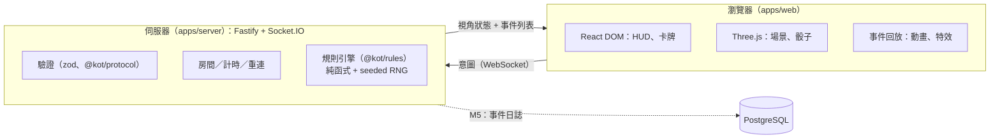
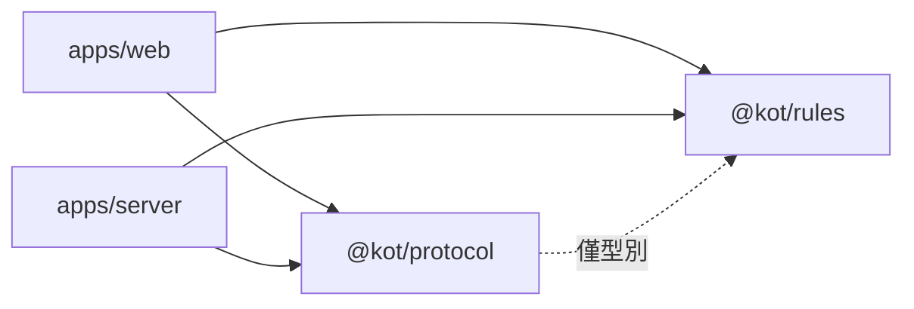

# 架構概觀

## 系統

- **客戶端只送意圖**（保留哪些骰子、購買哪張卡），伺服器驗證並擲骰，再廣播每位玩家視角的狀態與事件列表。
- **規則引擎**是 `reduce(state, action) → { state, events }` 的純函式；RNG 狀態在 state 內，因此「初始 seed + action log」可完整重放。
- **3D 演出是事件的回放**：動畫不影響遊戲狀態，可跳過、加速或在低畫質下簡化。

詳見 [ADR-0002](adr/0002-server-authoritative-socketio.md)、[ADR-0003](adr/0003-3d-scope-and-art-direction.md)、[ADR-0005](adr/0005-lobby-sessions-and-timers.md)（M2：身分、房間、計時）、[ADR-0006](adr/0006-card-engine.md)（M3：卡牌引擎、隱藏資訊、協定 v3）。

## 套件依賴方向

`@kot/rules` 與 `@kot/protocol` 不依賴任何 app。`@kot/protocol` 只以型別引用 `@kot/rules`（`GameState`、`GameEvent`），沒有執行期依賴。

## 里程碑與狀態

| 里程碑 | 內容                                                                                 | 狀態                                                                          |
| ------ | ------------------------------------------------------------------------------------ | ----------------------------------------------------------------------------- |
| M0     | 骨架、環境、文件、CI                                                                 | **完成並已合併**（PR #1；沙盒與使用者 Mac 實測通過）                          |
| M1     | 規則引擎（無卡牌）：擲骰、結算、東京市／灣、讓位、淘汰、勝負（含 R-END）、支援多勝者 | **完成並已合併**（PR #2；沙盒與使用者 Mac 實測通過）                          |
| M2     | 連線與簡易 UI：大廳、房間、重連、計時                                                | **完成並已合併**（PR #3；沙盒、使用者 Mac 與 CI 通過）                        |
| M3     | 卡牌系統（可抽換卡組）：商店、買牌、約 60 種效果、提示、復活／搭檔、協定 v3          | **實作完成**（分支 m3/cards；沙盒測試通過；待獨立審查、使用者 Mac 實測與 PR） |
| M4     | 美術與 3D：風格化 UI、場景、破壞與打擊感、低畫質模式                                 | 未開始                                                                        |
| M5     | 品質與上線：事件日誌、負載測試（10,000 連線）、Snyk、部署                            | 未開始                                                                        |
| M6     | 選配：機器人、觀戰、Duel 模式、手機                                                  | 未開始                                                                        |

## M0 驗證狀態（2026-11-06）

| 項目                           | 狀態                                                    | 說明                                                                            |
| ------------------------------ | ------------------------------------------------------- | ------------------------------------------------------------------------------- |
| lint／typecheck／test／build   | **Tested（沙盒＋使用者 Mac）**                          | `pnpm run check` 全部通過，35 個測試                                            |
| 本機 `pnpm install`（Big Sur） | **Tested（使用者）**                                    | esbuild 0.25.12                                                                 |
| `docker compose up --build`    | **Tested（使用者，Docker 20.10.17 / Compose v2.10.2）** | 三個服務啟動，`/healthz` 回 ok                                                  |
| 正式 server 映像               | **Tested（使用者）**                                    | 建置、啟動、優雅關閉；映像內沒有套件管理器                                      |
| WebGL2                         | **Tested（使用者）**                                    | 支援                                                                            |
| 依賴漏洞                       | **Tested（使用者）**                                    | `snyk test --all-projects`、`snyk container test`、`pnpm audit --prod` 皆無漏洞 |
| GitHub Actions CI              | **Tested（使用者，M2 起）**                             | 使用者回報 M2 的 CI 跑過；M0／M1 當時未個別確認                                 |

## M1 驗證狀態（2026-11-06）

| 項目                                            | 狀態                           | 說明                                                         |
| ----------------------------------------------- | ------------------------------ | ------------------------------------------------------------ |
| `pnpm run check`（含 148 個規則引擎測試）       | **Tested（沙盒＋使用者 Mac）** | 格式、lint、typecheck、全部測試、建置通過                    |
| `snyk test --all-projects`、`pnpm audit --prod` | **Tested（使用者）**           | 5 個專案無漏洞；`@kot/rules` 新增的 fast-check 只是 dev 依賴 |
| `snyk container test kot-server`                | **Tested（使用者）**           | 19 個 Alpine 套件無漏洞；映像內沒有套件管理器                |
| 獨立審查                                        | **Reviewed（子代理，唯讀）**   | 沒有違反規則編號的缺陷；防禦性建議已修                       |
| GitHub Actions CI                               | **未個別確認**                 | 使用者回報 M2 的 CI 跑過                                     |

## M2 驗證狀態（2026-11-07）

| 項目                                                             | 狀態                             | 說明                                     |
| ---------------------------------------------------------------- | -------------------------------- | ---------------------------------------- |
| `pnpm run check`（規則 151、協定 26、網頁 18、伺服器 64 個測試） | **Tested（沙盒＋使用者 Mac）**   | 全部通過                                 |
| 雙瀏覽器對局、重新整理接回                                       | **Tested（沙盒 Playwright）**    | 建房、加入、準備、開始、打完一局         |
| 對局、重連、逾時代打、斷線                                       | **Tested（使用者，真實瀏覽器）** | 皆符合預期                               |
| 獨立審查                                                         | **Reviewed（子代理，唯讀）**     | 計時可被重連拖延、大廳離線佔位等問題已修 |
| 握手限流、每 IP 限制                                             | **未做（M5）**                   | 見 ADR-0005 的已知缺口                   |
| Docker 內的 M2 對局                                              | **未實測**                       | 沙盒沒有 Docker                          |
| GitHub Actions CI                                                | **Tested（使用者）**             | M2 的 PR 通過                            |

## M3 驗證狀態（2026-11-08）

| 項目                                                                           | 狀態                          | 說明                                                     |
| ------------------------------------------------------------------------------ | ----------------------------- | -------------------------------------------------------- |
| `pnpm run check`（規則 265、卡牌組 19、協定 29、網頁 26、伺服器 76 個測試）    | **Tested（沙盒）**            | 格式、lint、typecheck、測試、建置通過；使用者 Mac 尚未跑 |
| 全部效果的整場模擬（不變量、重放一致）、含使用者自備 77 張卡表的機器人整場模擬 | **Tested（沙盒）**            | 77 張全部成功匯入並對應效果                              |
| 協定涵蓋度：引擎的每種合法動作都通過協定驗證，且房間可打完整局                 | **Tested（沙盒）**            |                                                          |
| 雙瀏覽器對局（買牌、提示、事件日誌顯示卡名）                                   | **Tested（沙盒 Playwright）** | 以建置產物與使用者自備卡組各跑一次                       |
| 獨立審查                                                                       | **Reviewed（子代理，唯讀）**  | 找到 7 項確認缺陷，已修正並補回歸測試（見 ADR-0006）     |
| Docker（掛載 card-sets、映像只含原創卡組）                                     | **未實測**                    | 沙盒沒有 Docker；請依 runbook 在 Mac 驗證                |
| 詮釋 OQ-C1…C9                                                                  | **待使用者確認**              | 見 rules-spec-cards.md                                   |

## 容量目標

同時 10,000 人在線（使用者指定）。MVP 單一實例、記憶體房間狀態；**尚未驗證**能否達標，M5 以 Linux 負載測試量測並決定是否分片。理由與擴展路徑見 ADR-0002。
