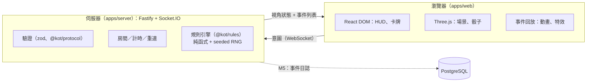
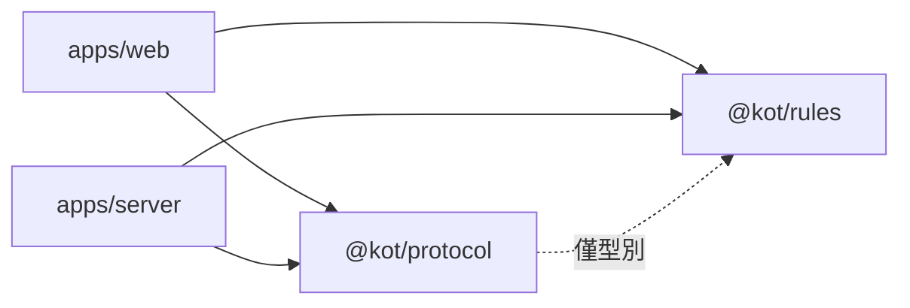
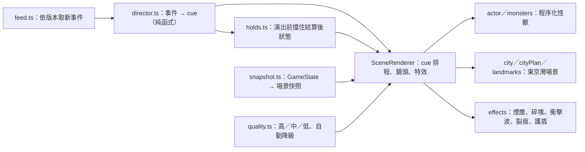

# 架構概觀

## 系統

- **客戶端只送意圖**（保留哪些骰子、購買哪張卡），伺服器驗證並擲骰，再廣播每位玩家視角的狀態與事件列表。
- **規則引擎**是 `reduce(state, action) → { state, events }` 的純函式；RNG 狀態在 state 內，因此「初始 seed + action log」可完整重放。
- **3D 演出是事件的回放**：動畫不影響遊戲狀態，可跳過、加速或在低畫質下簡化。

詳見 [ADR-0002](adr/0002-server-authoritative-socketio.md)、[ADR-0003](adr/0003-3d-scope-and-art-direction.md)、[ADR-0005](adr/0005-lobby-sessions-and-timers.md)（M2：身分、房間、計時）、[ADR-0006](adr/0006-card-engine.md)（M3：卡牌引擎、隱藏資訊、協定 v3）。

## 套件依賴方向

`@kot/rules` 與 `@kot/protocol` 不依賴任何 app。`@kot/protocol` 只以型別引用 `@kot/rules`（`GameState`、`GameEvent`），沒有執行期依賴。

## 里程碑與狀態

| 里程碑 | 內容                                                                                 | 狀態                                                                                      |
| ------ | ------------------------------------------------------------------------------------ | ----------------------------------------------------------------------------------------- |
| M0     | 骨架、環境、文件、CI                                                                 | **完成並已合併**（PR #1；沙盒與使用者 Mac 實測通過）                                      |
| M1     | 規則引擎（無卡牌）：擲骰、結算、東京市／灣、讓位、淘汰、勝負（含 R-END）、支援多勝者 | **完成並已合併**（PR #2；沙盒與使用者 Mac 實測通過）                                      |
| M2     | 連線與簡易 UI：大廳、房間、重連、計時                                                | **完成並已合併**（PR #3；沙盒、使用者 Mac 與 CI 通過）                                    |
| M3     | 卡牌系統（可抽換卡組）：商店、買牌、約 60 種效果、提示、復活／搭檔、協定 v3          | **完成並已合併**（PR #4；OQ-C 詮釋已確認並實作，僅 C2「他人回合空檔使用」未做）           |
| M4     | 美術與 3D：風格化 UI、場景、破壞與打擊感、低畫質模式                                 | **實作完成**（分支 m4/scene；沙盒測試通過；待使用者 Mac 實測與 PR 合併）                  |
| M4.5   | 遊戲 HUD：3D 區內完整操作、卡牌／骰子／勝利條件說明                                  | **實作完成**（分支 m4/game-hud，疊在 m4/scene 上；沙盒測試通過；待使用者實測）            |
| M4.6   | 地圖不被 HUD 遮住（並排／固定地圖版面）、拖曳與縮放地圖                              | **實作完成**（分支 m4/map-view，疊在 m4/game-hud 上；沙盒測試通過；待使用者實測）         |
| M4.7   | 鏡頭自動跟隨行動中的怪獸                                                             | **實作完成**（分支 m4/camera-follow，疊在 m4/map-view 上；沙盒測試通過；待使用者實測）    |
| M4.11  | 單一容器的試玩版 image（Cloud Run）：伺服器供網頁、記憶體、房間 5／連線 30 上限      | **實作完成**（分支 demo/cloud-run；沙盒以 node 驗證；image 建置與部署未實測）             |
| M4.10  | 12 種怪獸造型＋12 種招式；每場開局伺服器隨機分配造型（`PlayerInfo.monster`）         | **實作完成**（分支 m4/monster-roster，疊在 m4/follow-fix 上；沙盒測試通過；待使用者實測） |
| M4.9   | 怪獸站位避開大型建物（障礙盒檢查）、6 種怪獸招式特效（可關閉）                       | **實作完成**（分支 m4/monster-fx，疊在 m4/notices 上；沙盒測試通過；待使用者實測）        |
| M4.8   | 提示（商店可買、重大事件）、離開商店確認、鏡頭開關圖示                               | **實作完成**（分支 m4/notices，疊在 m4/camera-follow 上；沙盒測試通過；待使用者實測）     |
| M5     | 品質與上線：事件日誌、負載測試（10,000 連線）、Snyk、部署                            | 未開始                                                                                    |
| M6     | 選配：機器人、觀戰、Duel 模式、手機                                                  | 未開始                                                                                    |

## M0 驗證狀態（2026-11-06）

| 項目                           | 狀態                                                    | 說明                                                                            |
| ------------------------------ | ------------------------------------------------------- | ------------------------------------------------------------------------------- |
| lint／typecheck／test／build   | **Tested（沙盒＋使用者 Mac）**                          | `pnpm run check` 全部通過，35 個測試                                            |
| 本機 `pnpm install`（Big Sur） | **Tested（使用者）**                                    | esbuild 0.25.12                                                                 |
| `docker compose up --build`    | **Tested（使用者，Docker 20.10.17 / Compose v2.10.2）** | 三個服務啟動，`/healthz` 回 ok                                                  |
| 正式 server 映像               | **Tested（使用者）**                                    | 建置、啟動、優雅關閉；映像內沒有套件管理器                                      |
| WebGL2                         | **Tested（使用者）**                                    | 支援                                                                            |
| 依賴漏洞                       | **Tested（使用者）**                                    | `snyk test --all-projects`、`snyk container test`、`pnpm audit --prod` 皆無漏洞 |
| GitHub Actions CI              | **Tested（使用者，M2 起）**                             | 使用者回報 M2 的 CI 跑過；M0／M1 當時未個別確認                                 |

## M1 驗證狀態（2026-11-06）

| 項目                                            | 狀態                           | 說明                                                         |
| ----------------------------------------------- | ------------------------------ | ------------------------------------------------------------ |
| `pnpm run check`（含 148 個規則引擎測試）       | **Tested（沙盒＋使用者 Mac）** | 格式、lint、typecheck、全部測試、建置通過                    |
| `snyk test --all-projects`、`pnpm audit --prod` | **Tested（使用者）**           | 5 個專案無漏洞；`@kot/rules` 新增的 fast-check 只是 dev 依賴 |
| `snyk container test kot-server`                | **Tested（使用者）**           | 19 個 Alpine 套件無漏洞；映像內沒有套件管理器                |
| 獨立審查                                        | **Reviewed（子代理，唯讀）**   | 沒有違反規則編號的缺陷；防禦性建議已修                       |
| GitHub Actions CI                               | **未個別確認**                 | 使用者回報 M2 的 CI 跑過                                     |

## M2 驗證狀態（2026-11-07）

| 項目                                                             | 狀態                             | 說明                                     |
| ---------------------------------------------------------------- | -------------------------------- | ---------------------------------------- |
| `pnpm run check`（規則 151、協定 26、網頁 18、伺服器 64 個測試） | **Tested（沙盒＋使用者 Mac）**   | 全部通過                                 |
| 雙瀏覽器對局、重新整理接回                                       | **Tested（沙盒 Playwright）**    | 建房、加入、準備、開始、打完一局         |
| 對局、重連、逾時代打、斷線                                       | **Tested（使用者，真實瀏覽器）** | 皆符合預期                               |
| 獨立審查                                                         | **Reviewed（子代理，唯讀）**     | 計時可被重連拖延、大廳離線佔位等問題已修 |
| 握手限流、每 IP 限制                                             | **未做（M5）**                   | 見 ADR-0005 的已知缺口                   |
| Docker 內的 M2 對局                                              | **未實測**                       | 沙盒沒有 Docker                          |
| GitHub Actions CI                                                | **Tested（使用者）**             | M2 的 PR 通過                            |

## M3 驗證狀態（2026-11-08）

| 項目                                                                           | 狀態                          | 說明                                                          |
| ------------------------------------------------------------------------------ | ----------------------------- | ------------------------------------------------------------- |
| `pnpm run check`（規則 274、卡牌組 19、協定 29、網頁 26、伺服器 76 個測試）    | **Tested（沙盒）**            | 格式、lint、typecheck、測試、建置通過；使用者 Mac 尚未跑      |
| 全部效果的整場模擬（不變量、重放一致）、含使用者自備 77 張卡表的機器人整場模擬 | **Tested（沙盒）**            | 77 張全部成功匯入並對應效果                                   |
| 協定涵蓋度：引擎的每種合法動作都通過協定驗證，且房間可打完整局                 | **Tested（沙盒）**            |                                                               |
| 雙瀏覽器對局（買牌、提示、事件日誌顯示卡名）                                   | **Tested（沙盒 Playwright）** | 以建置產物與使用者自備卡組各跑一次                            |
| 獨立審查                                                                       | **Reviewed（子代理，唯讀）**  | 找到 7 項確認缺陷，已修正並補回歸測試（見 ADR-0006）          |
| Docker（掛載 card-sets、映像只含原創卡組）                                     | **未實測**                    | 沙盒沒有 Docker；請依 runbook 在 Mac 驗證                     |
| 詮釋 OQ-C1…C9                                                                  | **已確認（使用者）**          | 已實作，僅 C2「他人回合空檔使用」未做；見 rules-spec-cards.md |

## M4 驗證狀態（2026-11-09）

| 項目                                                                        | 狀態                          | 說明                                                                                                                                             |
| --------------------------------------------------------------------------- | ----------------------------- | ------------------------------------------------------------------------------------------------------------------------------------------------ |
| `pnpm run check`（規則 274、卡牌組 19、協定 29、網頁 86、伺服器 76 個測試） | **Tested（沙盒）**            | 格式、lint、typecheck、測試、建置通過；使用者 Mac 尚未跑                                                                                         |
| 雙瀏覽器對局到結束（建置產物）                                              | **Tested（沙盒 Playwright）** | 無 console 錯誤；結束後場景標籤的 HP／VP 與 DOM 表格一致、動畫佇列排空                                                                           |
| 繪製量（軟體算圖統計）                                                      | **Tested（沙盒）**            | 高：約 82 draw calls／5.2 萬三角面；中：57／2.9 萬（預算 <100／<10 萬）                                                                          |
| **FPS（≥30，基準機）**                                                      | **未實測**                    | 沙盒是軟體算圖，FPS 不具代表性；請依 runbook 在 2014 MBP 量測                                                                                    |
| 獨立審查                                                                    | **Reviewed（子代理，唯讀）**  | 13 項發現，高／中／低共 11 項已修（受傷保留未解除、事件與快照順序、canvas 重用等）；演出時間縮放造成撞擊與出拳不同步（輕微）、每幀小量配置未處理 |
| 怪獸造型                                                                    | **原創、程序化**              | 參考圖只用於比例與風格，不複製任何既有角色；第三方 GLB 資源庫（Polyfork）無法從沙盒取得、授權未確認，未使用                                      |

## M4.10 驗證狀態（2026-11-10）

| 項目               | 狀態                          | 說明                                                                                                                             |
| ------------------ | ----------------------------- | -------------------------------------------------------------------------------------------------------------------------------- |
| 分配邏輯           | **Tested（單元＋房間測試）**  | `pickMonsters` 不重複、在範圍內、可注入亂數重現、長期分佈涵蓋全部造型；房間開局後每人造型不同並隨房間狀態廣播                    |
| 協定               | **Tested**                    | `PlayerInfo.monster`（大廳為 null）；新增欄位、舊客戶端忽略即可，所以未升 `PROTOCOL_VERSION`；新客戶端遇到 null 時退回依座位輪流 |
| 造型大小／面數     | **Tested（單元）**            | 12 種都檢查：高度 3.8–6.4、寬度、面數 < 12k、最多 6 個 mesh                                                                      |
| 新造型與招式的外觀 | **Tested（沙盒 Playwright）** | 6 隻新怪獸與 6 種新招式逐一截圖檢視；風格是低多邊形，不是精緻模型                                                                |
| 手感、FPS、真機    | **未實測**                    | 沙盒軟體算圖；造型都在 ADR-0003 的面數預算內，但請在基準機確認                                                                   |
| 隨機分配的公平性   | **設計決定**                  | 純外觀；使用 CSPRNG 洗牌，不使用對局 seed（機密），房主無法指定                                                                  |
| 獨立審查           | **未做**                      |                                                                                                                                  |

## M4.9 驗證狀態（2026-11-09）

| 項目                                | 狀態                          | 說明                                                                                                                                     |
| ----------------------------------- | ----------------------------- | ---------------------------------------------------------------------------------------------------------------------------------------- |
| `pnpm run check`（網頁 128 個測試） | **Tested（沙盒）**            | `occlusion.test.ts`：鐵塔會擋、城市／海灣位置不會被擋、n=1..6 的環形座位從總覽與跟隨鏡頭都不被擋、座位間距；`attackFx.test.ts`：招式資料 |
| 站位                                | **Tested（沙盒 Playwright）** | `RING_RADIUS` 13.5，並跳過 212°–252° 的鐵塔弧（`BLOCKED_ARC`）；檢視總覽與跟隨截圖，怪獸不再與鐵塔重疊                                   |
| 招式特效                            | **Tested（沙盒 Playwright）** | 6 種招式逐一播放並檢視截圖（吐息、墨汁鞭、雷射、噴火、爪擊、搥地都有出現）；無 console 錯誤                                              |
| 特效的手感、FPS、粒子負載           | **未實測**                    | 沙盒是軟體算圖；特效沿用既有粒子池並依畫質縮放數量，光柱最多 3 個、爪痕最多 3 個（約 +6 個 draw call）；請在基準機確認                   |
| 障礙盒精確度                        | **近似**                      | 用方盒近似地標，不是真正的射線碰撞；跟隨鏡頭以預設拉近倍率計算，使用者自行縮放／平移後仍可能被擋                                         |
| 獨立審查                            | **未做**                      |                                                                                                                                          |

## M4.8 驗證狀態（2026-11-09）

| 項目                                | 狀態                          | 說明                                                                                |
| ----------------------------------- | ----------------------------- | ----------------------------------------------------------------------------------- |
| `pnpm run check`（網頁 116 個測試） | **Tested（沙盒）**            | 重大事件挑選（`notices.ts`）與離開商店規則（`shopGate.ts`）有單元測試               |
| 雙瀏覽器打一局                      | **Tested（沙盒 Playwright）** | 商店提示、「離開商店」→「結束回合」、各類事件提示都出現；無 console 錯誤            |
| 提示時機與 3D 演出同步              | **已知限制**                  | 提示在事件抵達時就跳出，3D 演出可能稍晚幾秒才播到（例如先看到「被淘汰」才看到倒下） |
| 獨立審查                            | **未做**                      |                                                                                     |

## M4.7 驗證狀態（2026-11-09）

| 項目                                | 狀態                          | 說明                                                                               |
| ----------------------------------- | ----------------------------- | ---------------------------------------------------------------------------------- |
| `pnpm run check`（網頁 105 個測試） | **Tested（沙盒）**            | 新增跟隨視角數學與偏好（舊偏好沒有欄位時預設開）的測試                             |
| 雙瀏覽器對局，輪替回合時的畫面      | **Tested（沙盒 Playwright）** | 檢視各回合截圖：鏡頭移到行動中的怪獸；演出時切到演出鏡頭；無 console 錯誤          |
| 移動過程的平滑度、暈動感            | **未實測**                    | 沙盒是軟體算圖，FPS 低，無法判斷順不順；請在真機確認，必要時調整拉近倍率或移動速度 |
| 獨立審查                            | **未做**                      |                                                                                    |

## M4.6 驗證狀態（2026-11-09）

| 項目                                                               | 狀態                          | 說明                                                                         |
| ------------------------------------------------------------------ | ----------------------------- | ---------------------------------------------------------------------------- |
| `pnpm run check`（網頁 103 個測試）                                | **Tested（沙盒）**            | 新增視角數學（拖曳／以游標縮放／上下限）的單元測試                           |
| 版面：1366×768、1100×700、iPad、iPhone 13 直向、iPhone 13 橫向模擬 | **Tested（沙盒 Playwright）** | 量測面板與地圖不重疊；直向捲動時地圖固定在最上方（sticky top = 0）；檢視截圖 |
| 滑鼠拖曳、滾輪、按鈕、雙擊、鍵盤、雙指縮放（合成 pointer 事件）    | **Tested（沙盒）**            | 重置按鈕出現／消失符合預期；真機手勢手感未實測                               |
| 基準機 FPS、真機觸控、iOS Safari                                   | **未實測**                    |                                                                              |
| 獨立審查                                                           | **未做**                      |                                                                              |

## M4.5 驗證狀態（2026-11-09）

| 項目                                                    | 狀態                          | 說明                                                      |
| ------------------------------------------------------- | ----------------------------- | --------------------------------------------------------- |
| `pnpm run check`（網頁 96 個測試）                      | **Tested（沙盒）**            | 新增定位與規則文字的單元測試                              |
| 桌面（1280）／平板（820，觸控）／手機（iPhone 13 模擬） | **Tested（沙盒 Playwright）** | 雙瀏覽器打完一局，無 console 錯誤；截圖檢視版面           |
| 卡牌說明：滑鼠 hover、觸控點擊、觸控長按                | **Tested（沙盒）**            | 長按以合成的 pointer 事件模擬；真機觸控手感未實測         |
| 鍵盤（Tab／Enter／Esc）、螢幕閱讀器                     | **未實測**                    | 已加 aria 屬性，沒有實際用輔助技術測過                    |
| 全螢幕                                                  | **未實測**                    | 沙盒沒有可用的全螢幕（Fullscreen API 在 headless 無意義） |
| 獨立審查                                                | **未做**                      |                                                           |

## 3D 場景模組（apps/web/src/scene，M4）

- **HUD（apps/web/src/hud）**：`GameHud` 與地圖**並排不重疊**：寬螢幕／橫向（≥640px 且寬≥高）地圖在左、HUD 在右（HUD 自己捲動）；直向時地圖 `position: sticky` 固定在上方（高約 42vh），HUD 在下方捲動；沒有 3D 時 `mode=flat` 放在頁面裡。內容相同：狀態列、骰子與動作、玩家／商店／事件／規則／我的卡牌分頁（骰子大小由 `--die` 控制）。`Tip` 元件統一處理 hover／點擊／長按／鍵盤，彈出框掛在 `document.body`，不被 3D 區裁切；規則文字（`rulesText.ts`）的數值取自本局設定。
- **動態載入**：`GameView` 以 `React.lazy` 載入 `Scene3D`；HUD、骰子與所有操作仍在 DOM，場景壞了或沒有 WebGL 遊戲照常可玩。
- **演出只是回放**：伺服器狀態一到就是「結算後」的樣子，`holds.ts` 讓畫面上的扣血、倒下、移動等到對應 cue 播到才更新；可跳過，切回分頁或捲回畫面時自動收尾。
- **地理**：從南向北看，西側是市區，東側是東京灣（見 ADR-0003）；城市外觀由房間代碼決定，所有玩家一致。
- **地圖視角**：`view.ts` 是純數學（平移＋縮放套在總覽姿態上、螢幕點對地面的射線求交、以游標縮放／拖曳平移讓「抓住的那塊地」跟著手指）；`SceneRenderer` 處理滑鼠、滾輪、單／雙指與鍵盤。視角非預設時暫停自動鏡頭（鏡頭回到玩家掌控），重置後恢復。
- **鏡頭跟隨**：沒有演出鏡頭時，`SceneRenderer.updateCamera` 把總覽姿態平移到行動中怪獸（`followView`，拉近 1.7 倍）；優先順序是「玩家手動視角 > 演出鏡頭 > 跟隨 > 總覽」。偏好 `follow`（預設開）存在 localStorage，與「鏡頭動態」一起受「減少動態」限制。
- **畫質**：高／中／低三檔，`auto` 只降不升（低於 26 FPS 時降級）；預設遵守「減少動態」設定。

## 容量目標

同時 10,000 人在線（使用者指定）。MVP 單一實例、記憶體房間狀態；**尚未驗證**能否達標，M5 以 Linux 負載測試量測並決定是否分片。理由與擴展路徑見 ADR-0002。
