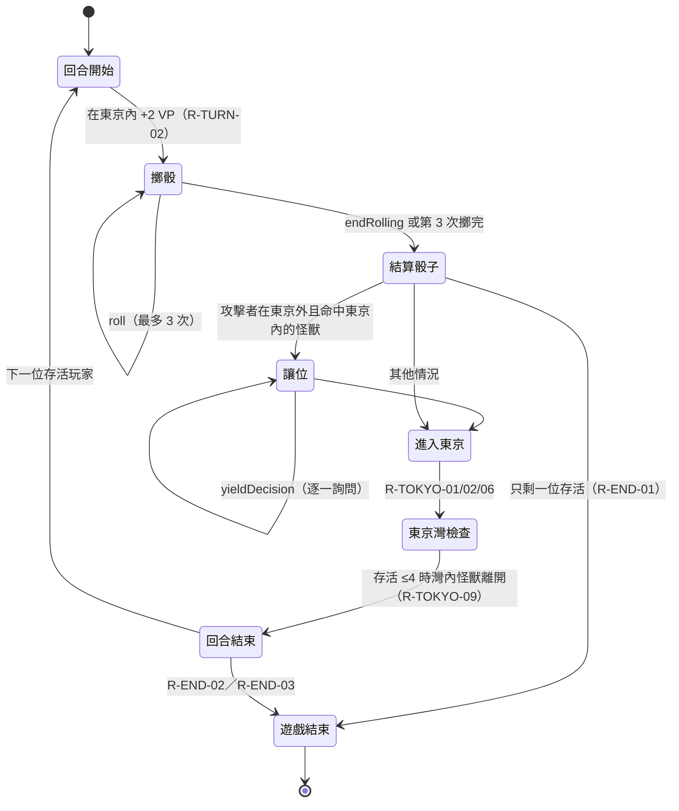

# 規則規格（rules-spec）

本文件是規則引擎的**唯一規則來源**。每條規則有編號，測試以編號標註對應關係（例如測試名稱含 `R-TOKYO-03`）。

- 狀態：**M1 定稿（無卡牌部分）**；卡牌規則（R-CARD）見 [rules-spec-cards.md](rules-spec-cards.md)（M3，含待使用者確認的詮釋 OQ-C1…C9）。
- 依據：`KOT2-rulebook_EN.pdf`（2016 第二版，下稱 **KOT2**）為基準；`king-of-tokyo-navodila.pdf` / `king-of-tokyo_rules.txt`（2012 初版，下稱 **KOT1**）用來補充與比對。
- 決策見 [ADR-0001](adr/0001-ruleset-and-end-conditions.md)。

## 1. 版本差異與採用決定

| 項目                  | KOT1（2012）                             | KOT2（2016）                                                   | 本專案採用                   |
| --------------------- | ---------------------------------------- | -------------------------------------------------------------- | ---------------------------- |
| 進入東京              | 第一個擲出攻擊的怪獸佔領東京，不造成傷害 | 結算後有獨立的「進入東京」步驟；東京沒人就必須進入，不需要攻擊 | **KOT2**                     |
| 回合步驟              | 擲骰、結算、買牌、結束                   | 擲骰、結算、**進入東京**、買牌、結束                           | **KOT2**                     |
| 讓位（Yield）         | 被攻擊後可讓位，攻擊者「必須」取代       | 同左，攻擊者在進入東京步驟移入                                 | KOT2                         |
| 被淘汰                | 未明確說明 keep 卡處理                   | 淘汰時 keep 卡與能量方塊被捨棄                                 | KOT2                         |
| 結束時機              | 達 20 分即結束                           | 「回合結束時」或剩一位怪獸                                     | **使用者自訂，見 R-END**     |
| Fire Breathing 兩人局 | 未說明                                   | 兩人局對手只失去 1 點                                          | KOT2                         |
| 能力卡文字            | 英文卡牌說明                             | 補充 Mimic、Poison/Shrink 計數、Metamorph 等說明               | 取兩者並集，衝突以 KOT2 為準 |

## 2. 規則清單

### 2.1 設置（R-SETUP）

| 編號       | 規則                                                                                                                                     |
| ---------- | ---------------------------------------------------------------------------------------------------------------------------------------- |
| R-SETUP-01 | 2–6 位玩家。每位怪獸起始 10 HP、0 VP。                                                                                                   |
| R-SETUP-02 | 2–4 人只使用東京市（Tokyo City）；5–6 人另加東京灣（Tokyo Bay）。                                                                        |
| R-SETUP-03 | 洗牌後翻開 3 張面朝上的能力卡。                                                                                                          |
| R-SETUP-04 | 先手：每人擲 6 顆黑骰，攻擊面最多者先手；平手者（只有平手者）重擲，直到決出。引擎以座位順序依序擲骰，使用同一個 seeded RNG，因此可重現。 |
| R-SETUP-05 | 開局沒有人在東京。                                                                                                                       |

### 2.2 回合（R-TURN）

| 編號      | 規則                                                                                    |
| --------- | --------------------------------------------------------------------------------------- |
| R-TURN-01 | 回合順序：回合開始效果 → 擲骰 → 結算骰子 → 進入東京 → 買牌 → 回合結束。順時針（向左）。 |
| R-TURN-02 | 回合開始時若在東京，獲得 2 VP。                                                         |
| R-TURN-03 | 回合結束時，回合結束效果依玩家選擇的順序結算，然後把骰子交給下家。                      |

引擎的回合狀態機（`phase`：`roll`／`yield`／`over`）。買牌步驟在 M3 加入，位置在「進入東京」之後。

### 2.3 骰子（R-DICE）

| 編號      | 規則                                                                                                                                                                                   |
| --------- | -------------------------------------------------------------------------------------------------------------------------------------------------------------------------------------- |
| R-DICE-01 | 每回合最多擲 3 次（首擲加最多 2 次重擲），可隨時停止。                                                                                                                                 |
| R-DICE-02 | 首擲擲全部 6 顆黑骰（加上卡牌賦予的綠骰）。重擲時可任選骰子，已放旁邊的骰子可以收回再擲。                                                                                              |
| R-DICE-03 | 面：1、2、3、能量、攻擊（Smash）、治療（Heal）。                                                                                                                                       |
| R-DICE-04 | 三顆相同的 1／2／3 得 1／2／3 VP（不是 3 / 6 / 9）；每多一顆相同點數再 +1 VP。                                                                                                         |
| R-DICE-05 | 每個能量面獲得 1 顆能量方塊，不需成組。能量可跨回合保留。                                                                                                                              |
| R-DICE-06 | 骰子必須全部結算。無卡牌時，各面互不影響，結果與順序無關；引擎固定依 VP → 能量 → 治療 → 攻擊 的順序結算並依序輸出事件。M3 加入卡牌後若順序會影響結果，再改為由玩家選擇（插斷式決策）。 |
| R-DICE-07 | 骰子結果由**伺服器**擲出（見 ADR-0002），客戶端只決定要保留哪幾顆。                                                                                                                    |

### 2.4 攻擊與治療（R-SMASH / R-HEAL）

| 編號       | 規則                                                                                           |
| ---------- | ---------------------------------------------------------------------------------------------- |
| R-SMASH-01 | 在東京內攻擊：對所有**不在**東京的怪獸各造成每個攻擊面 1 點傷害。                              |
| R-SMASH-02 | 在東京外攻擊：對所有**在**東京（市或灣）的怪獸各造成每個攻擊面 1 點傷害。                      |
| R-SMASH-03 | 東京內的怪獸之間不會互相攻擊。                                                                 |
| R-SMASH-04 | 被攻擊後 HP 歸零即淘汰；淘汰時其 keep 卡與能量方塊被捨棄。                                     |
| R-SMASH-05 | 只有「攻擊面造成的傷害」才算攻擊；卡牌造成的傷害不是攻擊，不能讓位、也不觸發只對攻擊生效的卡。 |
| R-SMASH-06 | 若攻擊因某效果實際造成 0 傷害，則不再視為攻擊（例如 Camouflage）。                             |
| R-HEAL-01  | 在東京外，每個治療面回復 1 HP；HP 上限 10（除非卡牌明確提高）。                                |
| R-HEAL-02  | 在東京內，骰子的治療面無效（卡牌仍可治療）。                                                   |

### 2.5 東京（R-TOKYO）

| 編號       | 規則                                                                                                                                                                                                                                                                                                                                |
| ---------- | ----------------------------------------------------------------------------------------------------------------------------------------------------------------------------------------------------------------------------------------------------------------------------------------------------------------------------------- |
| R-TOKYO-01 | 結算骰子後，若東京市沒人，你若在東京外就**必須**進入東京市。                                                                                                                                                                                                                                                                        |
| R-TOKYO-02 | 5–6 人時，若東京市已有人、東京灣沒人，你若在東京外就必須進入東京灣。                                                                                                                                                                                                                                                                |
| R-TOKYO-03 | 進入東京時獲得 1 VP。                                                                                                                                                                                                                                                                                                               |
| R-TOKYO-04 | 被攻擊面傷害的東京內怪獸，可選擇讓位（Yield）；仍然承受該次傷害。攻擊者在「進入東京」步驟移入其位置。**決定順序：從攻擊者的下一位開始順時針逐一詢問**（規則書未規定，引擎假設；此順序只影響誰先決定，不影響結果，因為每位的決定彼此獨立）。已被淘汰的怪獸不會被詢問。                                                               |
| R-TOKYO-05 | 只有承受攻擊面傷害時才能讓位，不可自行離開。                                                                                                                                                                                                                                                                                        |
| R-TOKYO-06 | 東京市優先：攻擊者需要進入東京時，先填東京市；東京市仍有人（沒有讓位）則進入空著的東京灣。若兩位都讓位，攻擊者進入東京市，東京灣暫時空著，之後由其他怪獸依 R-TOKYO-02 補上（見五人局範例）。                                                                                                                                        |
| R-TOKYO-07 | 被攻擊淘汰的東京怪獸，攻擊者在進入東京步驟移入。被卡牌淘汰則東京位置變空，沒人接替。                                                                                                                                                                                                                                                |
| R-TOKYO-08 | 一位怪獸不能同時佔有東京市與東京灣。                                                                                                                                                                                                                                                                                                |
| R-TOKYO-09 | 存活怪獸降到 4 位以下時，東京灣不再可用（東京灣可用 ⇔ 存活 ≥ 5）；東京灣中的怪獸必須離開，若東京市是空的則改移到東京市。**檢查時機：在回合的「進入東京」步驟之後**，因此被攻擊淘汰的東京市怪獸，其空位先由攻擊者依 R-TOKYO-07 移入，東京灣怪獸再離開。**此移動不是「進入東京」，不得獲得 VP**。（兩點規則書都沒明說，是引擎假設。） |
| R-TOKYO-10 | 卡牌上的「東京」同時指東京市與東京灣。                                                                                                                                                                                                                                                                                              |

### 2.6 能力卡（R-CARD）

| 編號      | 規則                                                                                                                                                                                                                                     |
| --------- | ---------------------------------------------------------------------------------------------------------------------------------------------------------------------------------------------------------------------------------------- |
| R-CARD-01 | 買牌時可購買任意張面朝上的卡，每張支付卡面費用的能量。購買後立即從牌堆補牌，新牌立即可買。                                                                                                                                               |
| R-CARD-02 | 可花 2 能量把 3 張面朝上的卡全部捨棄並翻出 3 張新牌；買牌與清牌可任意順序，直到能量用完。                                                                                                                                                |
| R-CARD-03 | Keep 卡保留在面前直到遊戲結束（除非卡牌另有說明）；Discard 卡立即結算後捨棄。                                                                                                                                                            |
| R-CARD-04 | 卡牌不能讓 HP 超過 10，除非卡牌明確寫了可以（例如 Even Bigger）。                                                                                                                                                                        |
| R-CARD-05 | 個別卡牌的補充說明（Mimic、Opportunist、Parasitic Tentacles、Metamorph、Poison Spit、Shrink Ray、Fire Breathing、Solar Powered、Drop from High Altitude、Eater of the Dead、Even Bigger）見 [rules-spec-cards.md](rules-spec-cards.md)。 |

### 2.7 勝負（R-END）

使用者已確認的結束條件（2026-11-05）：**「某玩家達 20 分且熬過自己回合後立即結束」或「整輪結束才判定」，兩者達成其一就結束。**

| 編號     | 規則                                                                                                                                                                                                                                                                                                                                                 |
| -------- | ---------------------------------------------------------------------------------------------------------------------------------------------------------------------------------------------------------------------------------------------------------------------------------------------------------------------------------------------------- |
| R-END-01 | **最後一位怪獸存活**時立即獲勝。                                                                                                                                                                                                                                                                                                                     |
| R-END-02 | **回合結算**：輪到某玩家的回合結束時（含回合結束效果結算完畢），若**該回合玩家**仍存活且 VP ≥ 20，遊戲立即結束，該玩家獲勝。                                                                                                                                                                                                                         |
| R-END-03 | **整輪結算**：一輪的最後一位玩家的回合結束時（即行動指標繞回先手之前），若有任何存活怪獸 VP ≥ 20，遊戲結束。                                                                                                                                                                                                                                         |
| R-END-04 | R-END-02 與 R-END-03 以先達成者為準。非回合玩家在他人回合達到 20 VP（例如因 Opportunist 買到加分卡）不會立即獲勝，要等 R-END-03 或輪到自己時的 R-END-02。**同一個回合結束同時符合兩者時**（該回合同時是一輪的最後一回合）：先套用 R-END-03，以所有 VP ≥ 20 的存活怪獸（含回合玩家）依 R-END-07 決勝；R-END-02 只在該回合**不是**一輪結尾時單獨生效。 |
| R-END-05 | 達 20 VP 但同回合因卡牌被淘汰，視為淘汰；必須**存活到回合結束**才能獲勝。                                                                                                                                                                                                                                                                            |
| R-END-06 | 所有怪獸同時被淘汰，則全員落敗。                                                                                                                                                                                                                                                                                                                     |
| R-END-07 | **整輪結算的勝負判定**（多位存活怪獸 VP ≥ 20 時）：依序比較 ① **VP** ② **剩餘 HP** ③ **能量** ④ **持有的 Keep 卡張數**，較多者獲勝；比到沒有東西可比仍相同才**並列獲勝**。（使用者 2026-11-06 確認「比到沒東西可以比才並列」，③④ 的項目與順序也已確認，見 OQ-5）                                                                                     |
| R-END-08 | 「一輪」的邊界由座位順序決定：先手之前的座位回合結束後為一輪結束。被淘汰的座位會被跳過，但邊界不變。                                                                                                                                                                                                                                                 |
| R-END-09 | **額外回合**（Frenzy、Freeze Time 等）屬於同一位玩家，**不推進座位、不改變一輪的邊界**。R-END-02 在每個回合結束時都會判定，因此若第一個回合結束時已達 20 VP，遊戲直接結束，不會再進行額外回合。（M1 前的設計假設）                                                                                                                                   |

## 3. Golden 測試（來自官方範例）

這些範例會直接轉成測試案例，確保引擎行為與規則書一致。

| 編號 | 來源            | 情境與預期                                                                                                                                                                                                                                                                                                                                                                                                                                                                    |
| ---- | --------------- | ----------------------------------------------------------------------------------------------------------------------------------------------------------------------------------------------------------------------------------------------------------------------------------------------------------------------------------------------------------------------------------------------------------------------------------------------------------------------------- |
| G-01 | KOT1 骰子範例   | Gigazaur 在東京外，最終骰面為四顆 2、一顆能量、一顆攻擊：得 2 + 1 = 3 VP、1 能量；CyberBunny 在東京，失去 1 HP。沒有擲出治療面（本來也已是 10 HP）。⚠️ 規則書文字中骰面符號遺失，「四顆 2」由「三顆相同得 2 VP 加額外一顆 +1」推得。                                                                                                                                                                                                                                          |
| G-02 | KOT2 骰子範例   | CyberKitty 在東京市，Gigazaur 擲出三顆 2＋第四顆 2、1 能量、1 攻擊：獲得 3 VP、1 能量；CyberKitty 失去 1 HP。                                                                                                                                                                                                                                                                                                                                                                 |
| G-03 | KOT2 五人局範例 | 座位：MD0（Mekadragon）、G1（Gigazaur，HP 8，**起始在東京市**）、SP2（Space Penguin，**起始在東京灣**）、K3（King）、CK4（CyberKitty）。① MD 擲出 4 攻擊：G、SP 都讓位，MD 進入東京市（+1 VP）。② G 擲出 1 攻擊：MD 不讓位；G 進入東京灣（+1 VP）。③ SP 擲出 1 攻擊：G 讓位、MD 不讓位；SP 進入東京灣。④ K、CK 各擲 0 攻擊。⑤ MD 回合開始 +2 VP，擲出 3 攻擊：G（HP 3→0）淘汰，存活降為 4，SP 必須離開東京灣，MD 獨自在東京。引擎測試以「指定骰面」重現這些步驟，不依賴亂數。 |

> 註：KOT1 與 KOT2 都有五人局範例，流程相同，只是角色名稱不同（KOT1 的 Kraken／CyberBunny 對應 KOT2 的 Space Penguin／CyberKitty）。M1 以 KOT2 為準，逐步推演並寫成測試。

## 4. 待確認事項（Open Questions）

| 編號 | 問題                                                                | 預設                         | 影響 |
| ---- | ------------------------------------------------------------------- | ---------------------------- | ---- |
| OQ-3 | 兩人局是否沿用同一套規則（官方另有 King of Tokyo Duel，是不同遊戲） | 沿用基礎規則，東京只有東京市 | M1   |

## 5. 已決議

| 編號 | 問題                                              | 決議                                                                                                                                       | 日期       |
| ---- | ------------------------------------------------- | ------------------------------------------------------------------------------------------------------------------------------------------ | ---------- |
| OQ-1 | 整輪結算時多位玩家 ≥ 20 VP 的勝負判定             | 比到沒東西可以比才並列；細節見 R-END-07                                                                                                    | 2026-11-06 |
| OQ-2 | 官方卡表的取得方式                                | 使用者已提供卡表 CSV（放在專案 context，**不提交到 Git**，原因見 [ADR-0004](adr/0004-swappable-card-sets.md)）；內容共 75 列、展開後 77 張 | 2026-11-06 |
| OQ-4 | Monster Sidekick 的共同勝利與單一勝者模型衝突     | **支援多勝者**：結果為 `winners: number[]`（座位集合）；R-END-07 並列也用同一結構。Sidekick 本身在 M3 實作                                 | 2026-11-06 |
| OQ-5 | R-END-07 ③④ 的比較項目與順序（能量、Keep 卡張數） | **使用者確認 OK**：VP → 剩餘 HP → 能量 → Keep 卡張數，再相同才並列                                                                         | 2026-11-06 |
